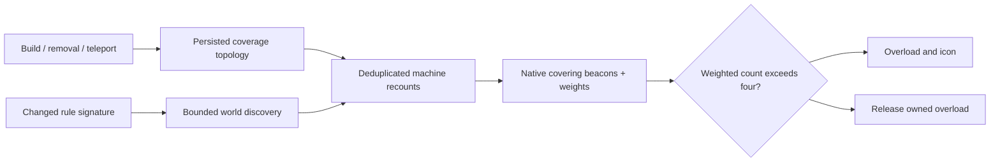

# Beacon upgrades, overload topology and native diminishing-return profiles

## Implementation sources

- [beacon-overload.lua](../../../exotic-space-industries-remembrance/scripts/control/beacon-overload.lua)
- [beacon-profile-config.lua](../../../exotic-space-industries-remembrance/lib/beacon-profile-config.lua)
- [module-policy-config.lua](../../../exotic-space-industries-remembrance/lib/module-policy-config.lua)
- [beacon-module-policy.lua](../../../exotic-space-industries-remembrance/scripts/control/beacon-module-policy.lua)

- [copper-beacon.lua](../../../exotic-space-industries-remembrance/prototypes/computer-age/copper-beacon.lua)
- [iron-beacon.lua](../../../exotic-space-industries-remembrance/prototypes/quantum-age/iron-beacon.lua)
- [alien-beacon.lua](../../../exotic-space-industries-remembrance/prototypes/alien-system/alien-beacon.lua)

## Ownership and behavior

Runtime overload is a separate rule from the data-stage diminishing-return curve. `beacon-profile-config` generates the native 4,096-entry profile, settings choices, and matching tooltip parameters; it has no runtime polling. The overload module counts eligible native covering beacons, applies weights/exclusions, and overloads eligible machines when the weighted count exceeds four. `entity.get_beacons()` supplies actual coverage before filtering; a distance-only replacement would change semantics.

`storage.ei.beacon_overload` owns tracked machines/beacons, persisted beacon-to-machine edges, destruction-registration mappings, refresh queues, rule signatures, modes and diagnostic state. `storage.ei.overload_icons` owns render references. On Factorio 2.1, state changes use `disabled_by_script` plus owned overload/icon state; release clears only the pause owned by overload. `active` is not the 2.1 actuator.

## Tick flow and bounded repair

The central per-tick fan-out calls `has_tick_work(event)` then `updater(event)`; the updater prefers the incoming tick. Work is mode-specific: release, machine recount, tracked reseed, or world discovery. World bootstrap discovers one chunk source and scans up to four chunks per tick; tracked/release limits are eight, with idle tracked/icon audit limits four/two every 60 ticks. Existing diagnostic helpers have eventless timing paths; changing those should use the common tick-policy review.

## Lifecycle and invariants

Destroy events remove graph relationships while the entity remains valid; object-destroyed registration supplies cleanup when it no longer is. Beacon teleport invalidates old edges before querying the destination, ensuring former neighbors are reconsidered. Configuration refresh compares the persisted rule signature (version 3); unchanged relevant rules avoid an unnecessary world rebuild. Disabling overload clears topology and queues release of owned overloads rather than leaving machines permanently inactive. Ordinary reload preserves queues/topology; a local surface iterator may be reconstructed.

## Module permissions and optional Quality

Quality is optional; Space Age and Recycler remain required. Three startup settings
control quality-module admission, productivity-module admission, and quality-module
effects. Each admission setting selects neither family, nitrogen only, Alien/Warp
only, or both. Copper/Iron form the nitrogen family; Alien/Warp form the other.
Defaults retain both permissions and ESIR effects. Vanilla-like effects skip ESIR's
three module-effect overrides while retaining ESIR recipes and research progression.

The config supplies each visible beacon's native allowed effects at declaration.
Speed, consumption and pollution remain allowed. Positive quality/productivity
bonuses require the corresponding permission; negative penalties do not require it.
NSBC sources remain dependency-owned and have no module slots for these beacons.
The late [description pass](../../../exotic-space-industries-remembrance/scripts/data-final-updates/beacon-profiles.lua)
and Informatron compose the same localized active policy.

`storage.ei.beacon_module_policy` records the last family permissions. Initialization
records the current policy. Configuration changes scan only beacon families whose
permissions tightened; legacy saves without this state are treated as previously
allowing both effects. Newly forbidden installed modules are spilled beside their
beacon with native stack quality and metadata preserved, then removed only after
the returned count is verified. Incomplete restitution fails visibly. Loosening
permissions and ordinary reload do not scan, and this module schedules no tick work.
Native beacon restrictions govern subsequent insertion; overload and profile rules
stay independent. Removed Quality content retains Factorio's native migration.

## Verification and maintenance

The current 1.4.0/2.1.23 integration is covered by the full-core native beacon, actor, client, ownership and two-client fixtures under `scripts/qc/factorio-2.1`. See [current acceptance](../handoffs/nonstandard-beacons-2.1/CURRENT_ACCEPTANCE.md) for exact candidate evidence and boundaries. The native fixture verifies weighted count 4 to 5 to 4 against actual `disabled_by_script` and recovery. Do not equate native profile effectiveness with the weighted runtime overload count. Historical profile/geometry evidence is retained separately; use version-pinned runners before extending those claims.

## Rebuild activity reporting

World discovery, chunk scanning, tracked-machine recounts and release passes publish topology generations at existing admission/service boundaries. Discovery remains indeterminate: chunk queue length is not a world denominator. Processors count completed/retired candidates; finite recount/release stages use actual work counts. Ordinary placement and idle topology maintenance are excluded. Replacement or disabled rebuilds retire the old generation.

## Native replacement declarations

Copper and Iron share the nitrogen family; Copper defaults to Iron in upgrade planners.
Alien and Warp share a separate bio-matter family; Alien defaults to Warp. Both pairs
allow manual replacement in either direction and eligible quality changes. Ruined
Alien containers remain outside these families and retain their repair workflow.

Nonstandard Beacons Continued owns hidden source handoff and orientation. ESIR retains
recipes, costs, ranges, slots, consumption, source lighting, repair event ordering and
both effectiveness systems. Copper to Iron changes overload weight from 1 to 2:
an upgrade can overload an existing layout. Alien and Warp remain excluded.

ESIR 1.4.0 already declares the continuation and these families. The historical deferred
patch is superseded and must not be reapplied. NSBC schema 2 uses native manager recipe
events with a persisted owner lookup; it rebuilds disposable controllers during adoption
without changing ESIR's source resources or overload/profile rules. Eligible upgrades
retain normal/quality source state; six Alien repair cases run the existing repair event
ordering before native Alien-to-Warp upgrades. Physical-input coverage remains distinct
from scripted native actions and actual multiplayer-client evidence.
