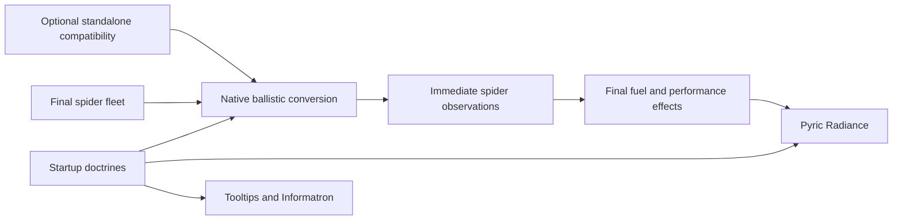

# Pyric Radiance and Ballistic Divergence

Four startup settings own two independent native-effect systems, both enabled with
Tempered by default. Ten doctrines per system share numerical records with startup
tooltips and Informatron. Selections persist while disabled. Concept credit:
DataCpt; independently authored implementation uses ESIR helpers and base art.
Optional counterpart identifiers occur only in dependency metadata. Runtime
warnings use the integrated names and leave both counterparts loadable.

## Implementation sources

- [pyric-radiance-config.lua](../../../exotic-space-industries-remembrance/lib/pyric-radiance-config.lua)
- [ballistic-divergence-config.lua](../../../exotic-space-industries-remembrance/lib/ballistic-divergence-config.lua)
- [combat-doctrines-dependencies.lua](../../../exotic-space-industries-remembrance/lib/combat-doctrines-dependencies.lua)
- [pyric-radiance.lua](../../../exotic-space-industries-remembrance/scripts/data-final-updates/pyric-radiance.lua)
- [ballistic-divergence.lua](../../../exotic-space-industries-remembrance/scripts/data-final-updates/ballistic-divergence.lua)
- [ballistic-divergence-compatibility.lua](../../../exotic-space-industries-remembrance/scripts/data-final-updates/ballistic-divergence-compatibility.lua)
- [surveyor-weapons-config.lua](../../../exotic-space-industries-remembrance/lib/surveyor-weapons-config.lua)
- [hide-surveyor-weapons.lua](../../../exotic-space-industries-remembrance/scripts/data-final-updates/hide-surveyor-weapons.lua)

## Ownership and flow

Configs own scalars; private effects and flight coverage are data-stage derivatives.
The optional standalone trajectory bridge runs early after assembler reskin.
Ballistics runs after fleet finalization and before spider observations. Radiance
runs last after fuel/performance aliases. Informatron reads stage-neutral configs.

## Standalone trajectory compatibility

The early optional bridge synchronizes all eight exotic magazines with the
standalone counterpart's uranium magazine capacity and first projectile delivery.
It copies target type, starting speed, angular/range deviation and maximum travel
when those fields exist, preserving each exotic projectile and complete payload.
The historical Surveyor restoration remains inactive. Counterpart detection reads
the shared dependency metadata; no integrated toggle gates this compatibility.

The late Ballistic Divergence pass treats that restored result as its baseline.
Enabled doctrines apply their capacity multiplier once and derive their own
scatter/travel; disabled integration preserves the standalone compatibility result.
The overlap fixture snapshots both sides of the early bridge and the late
conversion boundary, including a Saturation capacity case.

## Payload preservation

Direct instant deliveries retain launch probability/repeats and source effects.
Each complete target payload moves to its own projectile; source-only siblings
remain instant. Unsupported conditional/scripted branches stay intact and are
reported once. Preserve source-type records/order. Capacity rounds upward once
per fully supported bullet item; shotgun/robot capacity stay native. Defender uses
its own payload. Shotguns retain cone, speed, geometry, pellet counts/penetration.
No new ammunition, progression or scripted damage.

Generated bullets use a 0.1-by-0.5 collision box and speed 1 tile/tick. `not-same`
prevents own-force interception; other allied forces and neutral terrain intercept.
Authored splash/fire filters stay intact. Piercing magazines receive a continuation
health budget of 25 times base physical damage. Native continuation crosses only
killed targets; a surviving target stops the projectile regardless of remaining
budget, as confirmed by the engine fixture and the
[Factorio developer explanation](https://forums.factorio.com/viewtopic.php?p=619879).
Exotic rounds remain single-impact.
Acquisition range/cooldown/damage modifiers stay native. Terrain floors
preserve stronger resistance and affect all physical damage sources.
Rock eligibility includes the native rock-classification flag, covering Gaia
boulders, plus legacy rock names for compatible prototypes without that flag.

## Bounded native travel

The hiding owner and ballistic pass share the pure parked Surveyor catalog.
Hidden active vehicle/spider mount guns remain compatible consumers; only hidden
catalog weapons are excluded. The shared baseline `B` covers compatible active
weapon acquisition range, ammunition range modifiers and muzzle allowance,
with normal-quality floors of 30 tiles for bullets and 1 for pellets.
Incoming delivery distances, including the implicit 1,000-tile default, never
raise this baseline. Defender uses its own attack parameters.

Doctrines supply fixed `overtravel_tiles` budgets: 0, 2, 0, 3, 8, 5, 6, 8, 11, 16.
Factorio 2.0.77 also scales native delivery travel by firing-weapon quality `q`;
mixed ammo/weapon probes confirm weapon ownership, including handheld guns.
For physical budget `O` and maximum supported multiplier `Q`, requested bullet
deviation is `0.40 * scatter`; pellets request their authored range deviation
times the shotgun variation multiplier. Effective deviation is
`min(requested, 2*O/(2*Q*B+O))`; delivery `max_range` is `B/(1-deviation/2)`.
The physical interval starts at `q*B` and ends no farther than `q*B + q/Q*O`.
Its global upper endpoint is `Q*B+O`; conservative scaling of muzzle allowance
covers every quality's acquisition reach. Incoming ranges remain irrelevant,
including when requested pellet deviation exceeds 2. At zero budget,
distance variation is zero; angular bullet scatter and native pellet cones stay
independent. Compatible weapons share a ceiling rather than receiving per-turret
limits. Objects inside it remain valid collisions.

With current maximum quality multiplier 1.5, bullets use baseline 49.7 and pellets
21.41875. Maximum-quality ceilings are 77.55/90.55 and 35.128125/48.128125 tiles
for Tempered/Terminal Barrage respectively. Defender retains its 30-tile normal
floor, so its maximum-quality ceilings are 48/61. This engine-backed correction
keeps the doctrine table's physical tile budgets unchanged.

Private bullets have speed/max speed 1, zero acceleration and launch-speed variation.
Pellets preserve native cone, count, geometry, speed, penetration and payloads.
Unsupported structures and non-progressing/decelerating external pellets retain
their branch and receive one exclusion report. Feasible original deliveries still
declare private helpers. Native expiry owns missed-round cleanup; no runtime scan
is added. A missing original projectile cannot supply a faithful saved helper.

## Thermal boundary

The fuel catalog enumerates thermal fires/stickers/streams and palettes. Acid and
bespoke energy effects are excluded. Fire/stream lights keep colors. Stickers have
no light field: visible-only native effects create 12-tick light helpers every 12
ticks, preserving damage/lifetime cadence. Finite ordinary effect registries
preserve authored exotic bursts, plasma, Tesla, Lance, Emerald and special death
effects. Ordinary light radii cap at 64 and intensity at [0,1]. Extra nuclear
illumination uses a separate 30-tick light helper; the existing camera effect,
duration and damage stay intact. Spread,
effect lifetimes, maps, flashlights, night vision and day cycle retain their owners.
Each light is transformed once from original values.

## Lifecycle

Stable private projectile/light identities exist even when disabled. Data rebuild
leaves baseline source references intact in that mode. No items/technology/storage
need migration. Validate partial magazines/live effects through startup changes.
Saved native stacks can retain more remaining rounds than a newly reduced magazine
capacity; do not resize or refill them. Engine transitions verify their exact
remaining-round consumption. Disabled sticker/flash helpers retain stable names
with zero light intensity, while saved projectile helpers retain impact payloads.
New travel bounds apply when rounds launch. Already launched native projectiles
finish with saved distances and payloads; no migration deletes or respawns them.
The native transition fixture saves a fired legendary projectile with ammunition
and turret damage bonuses; disabled/Tempered rebuilds retain its single 45-damage
impact and exact saved magazine consumption. Both selections remain saved while
the toggles are disabled.

## Optional overlap warnings

[compat.warn_combat_overlap](../../../exotic-space-industries-remembrance/scripts/control/compat.lua)
checks each enabled startup toggle independently against optional dependency
metadata and prints one warning for that integrated system to a connected player.
[The shared dispatcher](../../../exotic-space-industries-remembrance/control.lua)
calls it only on `on_player_joined_game` and for connected players on
`on_singleplayer_init`. These hooks cover multiplayer joins and singleplayer save
loads; respawns and cutscene completion do not repeat the warning. No persistent
warning state or timer is needed. Neither `on_load` nor data-stage logging tries
to access players. Disabling a toggle preserves its saved doctrine selection.

## Timing

Combat effects need no control handler, script scheduler or runtime scan. The
load-entry warning is an untimed, read-only check with native player printing.
Native projectile simulation and sticker cooldown effects own engine work.
Evaluate rendering and simulation
separately from script UPS.

## Verification and limits

Use [the QC driver](../../../scripts/invoke-combat-doctrines-qc.ps1) and
[fixture notes](../../../scripts/qc/combat-doctrines/README.md). Cover twenty
doctrines/four toggle combinations, payloads, pellet counts, research/quality,
Defender/spiders, collision/penetration/range and save transitions. Headless results
cannot establish appearance; inspect graphical night scenes. Reports stay ignored.

Current focused engine evidence on 2.0.77 covers 24 final-data phases, 109 firing
cases per selected runtime doctrine, four real-counterpart toggle/load cases,
native save transitions, and shared localization translation. Night captures
cover disabled, Tempered and Apotheosis presentation with actual silo launches.
The separate 100-turret rendering scene contains 300 active projectiles and no
screenshot work. Its frame interval is display-limited, so CPU preparation/render
timings and headless simulation are useful bounded measurements; they do not
establish uncapped GPU cost or whole-factory UPS. MP client rejoin is not covered
by the singleplayer overlap fixture.
