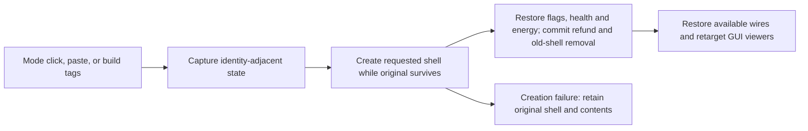

# Combustion turbine shell switching

## Implementation sources

- [combustion-turbine.lua](../../../exotic-space-industries-remembrance/scripts/control/combustion-turbine.lua)

## Ownership and reference flow

Solid and fluid fuel modes use different native turbine entities. `storage.ei.combustion_turbine` owns turbine records, proxy-to-owner mappings, object-destruction registrations, and GUI sessions. A hidden fluid-mode proxy provides an openable GUI anchor.

## Tick flow and invariants

This system is event-driven and has no production periodic updater. Event objects/numeric ticks flow through registration, shell swaps, GUI updates, and rebuilds. `now_tick` normalizes absent input to zero through `ei_lib.get_event_tick`, making its written `or game.tick` branch unreachable; some GUI boundaries explicitly capture `game.tick` before normalization. A successful shell swap changes unit number: capture connections and open players before destruction, then retarget every mapping. Switching to fluid mode refunds queued burner inventory only after replacement creation succeeds.

## Creation and custody boundary

The unlike native shells briefly overlap within the same event. Until the requested
shell exists, the original retains identity, queued and currently burning fuel,
connected fluid, GUI proxy and viewers. Creation failure returns that original
without spilling inventory or reconstructing a lossy copy. Commit preserves quality,
health, electrical energy, mining/destruction/operation/rotation flags and
`disabled_by_script`. Supported real wire connectors are captured through the
bound native method. The current native turbine bodies expose no red circuit
connector; this guard does not invent circuit support.

Successful fluid-to-solid switching retains its existing behavior: the fluid-only
storage disappears with the removed shell. This is distinct from the failed-switch
custody guarantee. No production cadence, recipe, efficiency, power limit or public
remote interface changes.

## Native window handoff

Opening a fluid console from another turbine's native window can synchronously
raise a close event for the previous body after the new GUI owner is assigned.
The close handler resolves the closed body/proxy's unit and ignores it when it
belongs to a different current owner. Closing the current console still tears
down its session. The existing one-tick proxy-close guard covers conversion of
the service-hatch window into its custom screen; no new scheduler is introduced.

## Lifecycle and cleanup

Object-destruction callbacks distinguish the turbine from its proxy. Loss of a proxy can recreate it for a surviving fluid shell; loss of the turbine tears down its record/session. Rebuild removes orphan proxies and reconstructs both shell modes. Failed replacement keeps the existing record and sessions.

## Verification contract

The focused exact 2.1.23 native fixture in `scripts/qc/factorio-2.1/turbine-runtime.lua`
passes 50 assertions for creation failure in both directions, successful solid-to-fluid
refunds, rare quality, health, energy, flags, destroyed-proxy recovery and owner
rebuild. A failed fluid switch preserves 230 diesel at 60 C; a failed solid switch
preserves 13 rare coal and 123,456 J of burning fuel. Both native bodies report no
red connector. Evidence is retained in the upgrade's managed run under
`turbine-runtime-21/native-02.*` and `native-03.*`.

The actual connected-player suite passes 63 assertions; its saved-player reload
passes 71 assertions in both headless and graphical runs, including the stale-window
close fix and native close/reopen. Both rendered panels were visually inspected.
A separate real 2.0-to-2.1 donor compares 41 fields and saves/reloads
again. The user accepted the independently reproduced native truncation of legacy
overfilled pipe segments; that narrow adjustment is recorded before strict reload
comparison. The [upgrade synopsis](../handoffs/factorio-2.1/UPGRADE_SYNOPSIS.md#turbine-transactions)
lists the receipts and render/multiplayer/performance limits.
