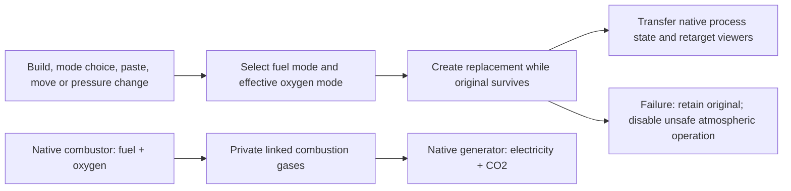

# Combustion turbine fuel and oxygen modes

## Implementation sources

- [combustion-turbine.lua](../../../exotic-space-industries-remembrance/scripts/control/combustion-turbine.lua)
- [combustion-turbine-process.lua](../../../exotic-space-industries-remembrance/scripts/control/combustion-turbine-process.lua)
- [combustion-turbine-config.lua](../../../exotic-space-industries-remembrance/lib/combustion-turbine-config.lua)
- [combustion-turbine-oxygen.lua](../../../exotic-space-industries-remembrance/prototypes/combustion-turbine-oxygen.lua)

## Ownership and reference flow

`storage.ei.combustion_turbine` owns visible turbine records, native generator
companions, dormant process contents, proxy mappings, destruction registrations,
surface membership, retry admission, and GUI sessions. Fuel mode and the player's
oxygen, ash and enabled preferences are independent. The original atmospheric
bodies remain, with an additional solid ash body; three fixed-recipe assembling
machines perform oxygen-fed combustion. Ash and ash-free generators have separate
native output ceilings and share the same working fluid.

## Pressure and preference

The shared `atmospheric_oxygen_min_pressure = 33` is used by both runtime
classification and the [oxygen-gas extraction recipe](../../../exotic-space-industries-remembrance/prototypes/computer-age/lufter.lua).
**Keep these requirements aligned:** extraction permits pressure **>= 33**, so
the turbine forces oxygen feed only at pressure **< 33**. Equality is atmospheric.
The extraction recipe's existing upper bound remains unchanged.

Below the threshold, the checked oxygen box is disabled and the stored preference
is retained. At or above it, the player can choose either mode. Leaving a forced
surface restores that choice. New and legacy untagged turbines default to
atmospheric preference. Blueprint tags `ei_combustion_turbine_mode` and
`ei_combustion_turbine_oxygen_fed` carry fuel mode and the actual stored boolean,
including false while oxygen feed is forced. Settings paste and clone use the
stored preference, not the current forced appearance. Tags
`ei_combustion_turbine_ash_generating` and `ei_combustion_turbine_enabled`
carry the other preferences. Untagged legacy records default to ash-free and
enabled, retaining any existing external disabled flag. Fluid mode remembers
the solid ash preference without applying its penalty or producing residue.

## Ash and enable controls

Solid ash operation reduces maximum power, electricity per chemical fuel, and
base pollution by 10%: normal-quality output is 10.8 MW, efficiency 270%, and
pollution 108/min. Atmospheric quality scaling is inherited. Oxygen ash operation
uses 10.8 MW process power and crafting speed 0.9 with the unchanged recipe,
producing 18 oxygen/s and 18 CO2/s at full load. Both oxygen generator variants
remain normal quality. Ash-free operation stays at 12 MW, 300% solid efficiency,
120 pollution/min and 20 oxygen/CO2 per second.

Three native burnt-result slots collect the fuel's final residue, including
non-ash results; fuels with no burnt result produce none. Native inventory
backpressure stops a full burner. Removing nonempty residue storage is rejected
before replacement, including switching to fluid fuel or pasting settings.
The complete settings request is rejected without changing preferences.

Enabled is a player preference separate from external disabling and pressure
safety holds. Off disables both native producers while retaining process
contents. Stored electrical charge can still discharge natively. No tick
production script implements any of these controls.

## Native production

The fixed recipe consumes 1 oxygen in 0.05 s and produces 1 combustion gas at
615 C. Its 15 C baseline and 1 kJ/unit/C heat capacity encode 0.6 MJ/unit.
The 12 MW combustor uses 300% solid-fuel or 225% fluid-fuel efficiency; the
generator converts those gases to electricity at 100% efficiency and outputs
one CO2 at 15 C per unit. This gives 20 oxygen/s and 20 CO2/s at 12 MW for every
accepted fuel. CO2 yield is deliberately uniform, not fuel-specific chemistry.

Oxygen and exhaust buffers are 200 units. Each private working-fluid buffer is
three units, for at most six units of queued gas. The small native buffers bound
run-on when oxygen stops or the exhaust fills. There is no energy/fluid production
script, emergency venting, or per-turbine accounting loop. Module slots, crafting
quality scaling, productivity, beacon effects and surface crafting effects are
disabled. The solid combustor retains three fuel slots; ash-free has zero residue
slots and ash mode has three;
fluid fuel retains the 60 units/s intake ceiling.

For north-facing machines, oxygen enters at the front/north and CO2 exits at the
rear/south. Fluid fuel keeps the two side connections. The working-fluid link is
private. Native engine backpressure and demand determine operation.

## Scheduling and invariants

`control.lua` is the only dispatcher. The updater is gated by occupied surfaces
and runs every 60 ticks. It queries pressure once per occupied surface, converting
turbines only on a classification change or a queued replacement retry.
GUI refresh covers only open panels, once per 60 ticks and immediately on opening
or changing controls. Each periodic refresh reads one snapshot per viewed turbine
and shares it across viewers; no history or persistent sampling is maintained.
Build and movement enforce current pressure
immediately. Production remains entirely native.

Callback ticks flow through registration, swapping and GUI handoff. A successful
replacement changes the unit number, so mappings and viewers follow the survivor.
No initialization or repair work is performed from `on_load`.

## Creation and custody boundary

Create the candidate shell and required generator before destroying the original.
A failed manual change leaves identity, fuel, fluids, state and preference intact.
If pressure requires oxygen but replacement fails, disable the unsuitable
atmospheric body and retry; preserve its previous script-disabled flag.

Oxygen/environment switches preserve queued and currently burning solid fuel,
connected fluid-fuel totals and temperature, process energy, in-progress craft,
oxygen, combustion gases, CO2 and native residue. Ash switches preserve these
contents too; rejected changes leave the original intact. While atmospheric mode is selected, process
contents are dormant and the retained generator is inactive. Excess electrical
charge from a larger quality atmospheric buffer is also kept dormant until a
later switch can accept it. The companion stays normal quality to enforce the
12 MW ceiling. This is custody at topology changes, with no tick servicing.
Repeated switches
must neither manufacture output nor consume extra fuel. Keep these invariants
under native tests rather than assuming writable fields reproduce native state.

Successful **fuel** switching retains the existing refund semantics: solid queued
fuel is spilled after candidate creation; fluid-only fuel is removed with the old
body. Quality, health, operation/mining/destruction/rotation flags and available
real circuit connections follow the replacement. These bodies do not gain
invented circuit connectors.

## Native window handoff

Oxygen-fed bodies use an assembling-machine relative panel. Atmospheric fluid
mode retains its existing central service-hatch proxy and detached console.
The oxygen toggle explains the pressure condition and ports. Forced state is
distinct from stored preference.

The panel separates Status, Generation and Options. Generation appears only in
oxygen-fed operation and reads the hidden generator's last-tick joules times 60,
quality-aware maximum production times 60, and their utilization ratio. It also
shows fuel, oxygen/CO2 buffers and residue occupancy. Status considers both native
bodies, so internal working-fluid backpressure is not labeled a blocked exhaust.
Options exposes fuel, oxygen, ash and Enabled. Ash is disabled in fluid mode.

A synchronous native close for an old window cannot close the newly retargeted
console. The existing one-tick proxy-close guard remains. Stale roots and sessions
are removed when the owner disappears or the player leaves.

## Lifecycle and presentation

Build/clone receivers return the valid survivor for later dispatcher receivers.
The visible body owns helper lifetime. Destruction unregisters and removes
companions; a missing companion can be recreated for a surviving body. Rebuild
retains saved preference/process records, reconstructs mappings, reconciles
pressure, and removes orphan companions. Helpers follow body movement/rotation
and are excluded from independent Dolly movement.
A direction change replaces the filled native generator at the new orientation,
preserving its fluids and electrical charge; native rotation cannot turn its axis.

Oxygen bodies inherit canonical turbine art, hit effects, interaction sounds and
the combustion death family through the existing registries. They remain hidden
operational variants, with the original item/technology/footprint. The invisible,
nonselectable generator has no independent scene or death effect. Native craft
and pipe UI expose oxygen and combustion gas; the private gas is not barrelable
or offered as player production.

## Verification contract

- test-suite: combustion-turbine-native-proof — isolated exact 2.1.24 native
  fuel/oxygen conversion, exhaust, backpressure, starvation and idle demand,
  with Quality enabled and disabled.
- test-suite: combustion-turbine — actual gameplay bodies and controller:
  rates, loaded toggle conservation against untouched controls, strict pressure
  boundary, forced retries, tag/paste behavior and ordinary save/reload.
  The expansion fixture covers ash balance, native residue/backpressure, rejected
  transitions, repeated loaded switches, enable holds and preference persistence.
- test-suite: build-dispatch — survivor and failure custody in the shared dispatcher.

Current receipts, GUI/render evidence and limitations belong in the task closeout.
Historical exact 2.1.23 evidence remains described in the
[upgrade synopsis](../handoffs/factorio-2.1/UPGRADE_SYNOPSIS.md#turbine-transactions):
50 native turbine assertions, 63 connected-player assertions and 71 reload
assertions. Those historical receipts do not establish current 2.1.24 acceptance.
