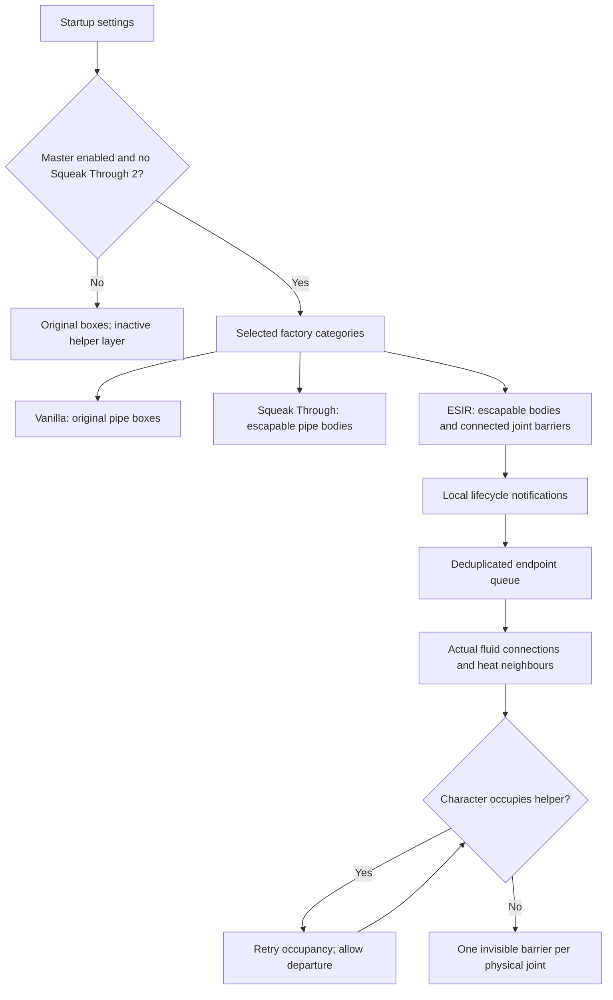

# Factory passage and pipe joints

This subsystem gives eligible grid-aligned factory bodies at least the ordinary
assembler's 0.6-tile clearance. Character dimensions, selection boxes, connection
coordinates, simulation and presentation remain owned by the original prototypes.
Five startup booleans select the master, Production, Power, Logistics and Turrets;
the sixth setting selects Vanilla, Squeak Through or ESIR pipe behavior. Defaults
enable all categories and select ESIR. Startup changes require a restart.
Three runtime-global controls apply on the next service tick. The main update
budget remains 1..1024 operations per tick, default 256. The circuit scanner is
disabled by default and has an additional 1..1024 attempts per tick when enabled,
default 1. Existing saved scanner choices remain authoritative. Native Mod settings
and Administration → Options → Performance edit the same saved values.

**Integration status:** collision geometry was accepted on Factorio 2.1.24. The
[acceptance handoff](../handoffs/factory-passage-acceptance-2026-11-01.md) records the
original geometry/movement acceptance and rendered demonstrations. The
[administration extension handoff](../handoffs/factory-passage-administration-2026-11-01.md)
records the runtime budget, native GUI and rebuild checks, repeated mode/transition
matrix, 80 matched trials at budgets 256/1024, exact source identities and remaining
multiplayer coverage.
The [observer/scanner handoff](../handoffs/factory-passage-observers-2026-11-01.md)
records revision 3, the independent scan budget, the guide, current-source evidence
and the separate physical recipe-picker and two-client acceptance boundaries.

## Implementation sources

- [Configuration](../../../exotic-space-industries-remembrance/lib/factory-passage-config.lua)
- [Helper prototypes](../../../exotic-space-industries-remembrance/prototypes/factory-passage.lua)
- [Final prototype policy](../../../exotic-space-industries-remembrance/scripts/data-final-updates/factory-passage.lua)
- [Runtime maintenance](../../../exotic-space-industries-remembrance/scripts/control/factory-passage.lua)

## Ownership and flow

`factory-passage-config` owns settings, type categories, operational-body exceptions,
helper identities and the three runtime controls' defaults and bounds. The final data pass runs after
operational variants exist. Its `mod-data` catalog records changed bodies, exclusions,
admitted pipe names and characters. Runtime consumes that immutable catalog.

Only collision boxes shrink; explicit tile dimensions preserve inferred placement
footprints. Existing larger clearances remain. Walls, gates, terrain, vehicles,
rolling stock, enemies, off-grid entities, author opt-outs and generic support
helpers are outside the type/admission policy. Hidden operating variants remain
eligible. The gate's animated collision owner follows its Logistics shell; induction
matrix core variants belong to Power. Boilers and reactors remain Power. The
Elevated Pipes registry identifies its real infrastructure separately from its
collisionless display helpers.

Already-walkable bodies remain walkable, including vanilla heat pipes. ESIR admits
pipe collision masks only when they match the native pipe's character collision
cohort; specialized incompatible masks retain their original box. Flying collision
masks are untouched. Unsupported body/port geometry is recorded as an exclusion.
Native port positions must still fit inside each narrowed pipe body in both
passage modes. If they do not, that prototype keeps its original box. An upgrade
family crossing an opt-out or unsupported shape also retains its original boxes
and explicit or inferred grid fields. Nonzero authored box orientations are not
flattened into rectangles. Eight-way and sixteen-way bodies without physical ports
use an inscribed square bound so mixed headings retain at least the same clearance;
their placement grids remain unchanged. Unsupported noncardinal native-pipe
receivers and sixteen-way physical ports protect their connection categories.

ESIR also validates normal fluid receivers, including direction-specific and
diagonal alternate ports. An unsupported receiver preserves original collision
for compatible pipe connection categories. A failed port in a dedicated custom
category stays local; a failure in the shared default category necessarily protects
stock pipes as well. This is a conservative compatibility fallback, not permission
to leave narrowed connected joints without their barriers.

## Native collision and helper geometry

Factorio 2.1.24 expands an ordinary pipe's placed collision toward connected pipes.
Native movement, rather than bounding-box inference, is the acceptance authority.
The first native-only proof blocked crossings, but forced construction around a
standing character trapped that character: 35 walking ticks produced zero movement.
Consequently standard pipes use narrower escapable bodies in both passage modes.
ESIR closes connections with deferred helpers; Squeak Through leaves the joints
open. This is an explicit fallback under the user's native-first approval.

The escapable native-pipe core is one fixed-point unit per half-axis (1/256 tile).
The native engine adds connection collision outside that core. This bound passed
normal, diagonal and accelerated ESIR walking as well as a grounded mech-armor
character leaving an occupied new joint. Character dimensions are unchanged.

Normal fluid connection records supply actual endpoints and port positions.
Underground and linked records never create span barriers. Heat neighbours establish
membership; heat-buffer or heat-energy-source ports resolve physical cardinal
joints, mirroring before rotation. Heat prototype vectors use array coordinates.
Both entity identities and quantized port positions form a symmetric physical key.

Helpers span facing body edges with 1/32-tile overlap, using permanent horizontal
and vertical length variants in 1/16-tile increments. Their dedicated layer collides
only with admitted grounded characters. Helpers are invisible, unselectable,
unminable, indestructible and absent from blueprints. They have no fluid or heat
state, construction collision or combat role. Existing entity death effects,
sounds, sprites and Factoriopedia presentation are inherited without mutation.
Ordinary pipe helpers attach to the authored solid core: the native enclosing box
includes connector extensions and empty corners. Already-walkable receivers,
including vanilla underground entrances, contribute their actual port point rather
than an artificial solid body. Underground spans and separate unconnected parallel
runs remain walkable. Adjacent ordinary rows cross-connect into a solid grid.
Diagonal receiver bodies use a square guaranteed inside their oriented native box,
not its larger enclosing rectangle. Walkable receivers are catalogued across all
physical receiver types, including those outside the general factory categories.

## Lifecycle and invariants

`storage.ei.factory_passage` owns endpoint records, canonical joints, destruction
registrations, dirty endpoints, pending occupancy and recipe observations. Ordinary
save/load preserves this state without rebuilding. Init/configuration change cleans
all helper identities and rebuilds only in effective ESIR mode. Other modes retain
helper prototypes but do not add the helper collision layer to characters.

Construction, revive, clone, removal, death, object destruction, rotation, flip,
paste and raised teleport events request local reconciliation through `control.lua`.
Surface removal drops its ownership; import reconstructs that surface. Helper
clones are discarded before normal dispatcher handling. No pipe is replaced,
teleported or drained. Mode transitions never rewrite fluids, quality, temperatures,
circuits or connection definitions.
Stationary fluid/heat receivers such as thrusters notify neighboring pipes even
when their own bodies are outside the passage categories. Moving receivers are
excluded centrally and never acquire a stationary joint helper.

Circuit-selected recipes have no dedicated native change event. Only pipe-adjacent
crafters with native circuit recipe selection or an open native entity GUI receive
bounded observations. Recipe-less circuit crafters remain admitted; closed manual
machines use lifecycle events and explicit notifications. Arbitrary silent recipe,
circuit-selection or connection changes by other mods require
`remote.call("ei_factory_passage", "refresh_entity", entity)`; event-driven maintenance
cannot guarantee discovery of unreported changes.

### Observer reasons and native GUI sessions

One watcher entry represents one machine. Independent circuit and GUI reasons may
overlap; multiple players viewing a machine do not multiply its queue entries.
Circuit admission reads only an existing assembling-machine control behaviour;
rocket silos do not expose that API. Proximity is cached by local reconciliation,
never searched during unchanged observer service. Losing the final nearby pipe
retires observation. No periodic fallback discovers closed manual machines.

Player-indexed `gui_sessions` and unit-indexed `gui_viewers` retain native opened
entities, including those without pipes. Every opened crafter has destruction
ownership even before a pipe is placed. GUI close/unrelated open, departure,
death, removal and controller changes reconcile or retire sessions. A raised
teleport rebinds surviving viewers. Remote viewing is independent of the character
surface. GUI hooks precede dispatcher early returns; they do not own a custom GUI.
Final close queues reconciliation, allowing native circuit selection enabled in
the GUI to retain its observer. Active observers validate only their own viewers.

Fusion reactors, auric vats and neutron collectors receive an injected module-local
recipe-change callback from `control.lua`. Successful changed writes notify passage
with the supplied tick; bodies without fluid ports are guarded out. Callbacks are
reinstalled at top-level load and are never stored. ESIR custom circuit/phase
systems therefore need no passage observer while their native GUI is closed.

State revision 3 retains reason counts and session ownership. Legacy watchers are
classified within their existing queue budget. Schema adoption preserves queues,
cursor, helpers and rebuild reports; a pending flag restores connected-player GUI
sessions at a game-available boundary even if an earlier event adopted the schema.
Init/configuration/repair reconstruct GUI sessions from connected players.
Ordinary `on_load` never mutates storage. The public refresh hook is unchanged.

Squeak Through 2 overrides this entire feature, including general collision changes
and helpers. “Vanilla” means the boxes supplied by the game and other mods before
this final policy applies, not a hard-coded base-game replacement.

## Timing

Callback ticks propagate into every queue operation. Init, configuration change and
remote calls obtain one current tick at their game-available boundary. Endpoint
reconciliation is eligible on the following tick so mining events can finish first.
Repeated compatibility refreshes deduplicate without postponing already queued
work; lifecycle notifications can defer to let the current native mutation finish.
The shared scheduler owns queues and uniqueness. The live runtime-global budget
bounds combined queue attempts, including stale entries, duplicates and deferred
work. A persisted six-dirty/one-pending/one-watcher slot cursor prevents starvation
even at budget one. Pending and watcher attempts each have a ceiling of
`ceil(budget/8)`, also bounded by starting queue populations; dirty work borrows
unused allowance. Per-joint and per-crafter tick guards prevent repeated occupancy
queries and recipe reads after queue compaction. At 256, fully populated classes
receive 192/32/32 attempts; at 1024, 768/128/128. The cumulative peak counter is a
historical maximum, not the current setting. Settled ordinary networks have no
topology queries, helper churn or periodic network scans.

The watcher slot serves GUI and unclassified legacy entries only. Circuit-only
machines use the additional deadline service described below.

Recipe-change checks observe recipe name, quality, fluid-port count, native circuit
selection and recorded viewer validity only on admitted crafters. Their count is
distinct watched machines, not completed
rebuild work. Changed signatures enqueue reconciliation; unchanged signatures
perform no topology query. The pace setting does not bound synchronous world
discovery, helper cleanup or immediate lifecycle invalidation.

## Independent circuit scanner

`ei-factory-passage-circuit-scanner-enabled` parks or enables background service;
`ei-factory-passage-circuit-scan-budget` limits additional attempted items, default
1 and range 1..1024. Each popped item costs one attempt, including invalid entries.
The circuit pass follows main maintenance, so detected changes reconcile no sooner
than the next tick. GUI ownership removes a machine from the circuit heap, while
both logical observation reasons remain visible. Starting population and a per-tick
guard prevent duplicate service. Completed scans and attempts have separate counters;
neither counts as rebuild progress.
GUI open/close and session replacement reclassify from cached proximity immediately,
so a dirty backlog cannot leave an open window waiting for a circuit deadline.
Unknown proximity and all topology changes still use deferred reconciliation.

`last_signature_tick` advances on every successful signature read, including an
unchanged background check or GUI observation. `last_reconciled_tick` advances only
after actual endpoint reconciliation, which also synchronizes the signature.
The circuit deadline is their maximum plus 60. Enqueueing, deferred dirty work and
failed occupancy retries do not refresh either clock. Lifecycle, GUI and explicit
recipe-change notifications bypass this background cooldown.

The shared scheduler's indexed deadline queue stores one numeric unit-number key
per circuit-only candidate, ordered by deadline then key. Its earliest node is the
constant-time admission cache. `control.lua` passes `event.tick` into `has_work`;
cooling or parked candidates admit no recurring service or traversal. Re-enabling
drains overdue candidates within the additional allowance without discovery or
helper reconstruction. Effective mode/master/companion precedence remains higher.

Revision 3 classifies legacy FIFO entries through their existing bounded service:
GUI entries stay, circuit-only entries move to deadlines, and other entries retire.
The unclassified count persists until exhausted. Schema adoption preserves original
queues, cursor, sessions, helpers and active rebuild report; load itself is pure.
Diagnostics expose settings, effective activity, registered candidate count, earliest
deadline and separate attempt/scan counters. Registration is distinct from activity.

## Engineer's guide

The ungated Factory passage page under New mechanics uses existing wrapped labels
and headings in all eight locales. It describes geometry, modes, controls, event
updates, GUI priority, circuit scanning, waits and authorized repair. Defaults come
from the configuration owner. The 600-machine, ten-second example assumes one attempt
per tick at 60 UPS and is illustrative, with backlog caveats. On explicit open only,
a detached `status()` snapshot reads scalar state and native settings. Rendering
never discovers entities, initializes gameplay state or queues maintenance; disabled
and companion-overridden modes remain explainable.

## Administration and rebuild activity

The explicit `factory-passage` registry owner exposes scalar diagnostics, bounded
inspection and the existing `(reason,tick)` repair entry point. Summary reads do
not initialize state or call gameplay getters. Configured/effective modes, the
inactive reason and current native setting remain readable while inactive.
`status()` preserves its existing fields and returns detached counters/rebuild
metadata. General passage enablement and ESIR helper activity are distinct.

Explicit init/configuration/repair/import reconstruction reports synchronous
`world-discovery` separately from asynchronous `joint-reconciliation`, both under
owner `factory-passage` and global scope. The module retains its report ID and
retired-operation count; the scheduler owns presentation records. Previous work
is superseded before replacing state. Unknown totals avoid invented percentages
or ETAs as new endpoints join. Unsuccessful retries and recipe checks do not add
completed work. Only `dirty_count == 0` and `pending_count == 0` completes a job.
`blocked_count` counts known character occupancy separately from pending tokens;
pending-only work waits for character clearance only when every remaining token
is known blocked. Stale tokens remain running until their bounded cleanup drains.

Normal maintenance admits no rebuild job. Watchers alone cannot keep one alive.
Waiting-only work remains in admin diagnostics and leaves the public active-work
window according to the shared monitor policy. Surface cleanup reconciles reports;
save/load preserves queues, class cursor and report identity without load mutation.
Pace changes neither rebuild helpers nor reset progress. Administration's repair
request receipt acknowledges dispatch, not completion of asynchronous work.

## Verification and limits

The [focused runner](../../../scripts/invoke-factory-passage-qc.ps1) stages an exact
Factorio 2.1.24 private fixture. Development receipts are retained under registered
`.factorio-qc/managed` run IDs; the final evidence handoff must distinguish static,
native movement/state, rendered, performance and multiplayer coverage.

Required acceptance includes the steam-crusher/burner-heater regression with the
steam assembler control; selected categories and exclusions; three modes and all
six transitions; standing-character construction; fluid/heat state; lifecycle and
reload; and matched 10k/100k networks over five runs. Performance must stay within
the larger of 5% or 0.1 ms/tick of baseline. Report helper count, memory and rebuild
latency separately. A positive unsupported-joint counter fails native acceptance.
The original geometry/administration matrix passed, including every paired steady-state timing threshold.
The 100k connected-grid burst is expensive in both modes and carries a substantial
helper memory cost; the handoff reports those measurements separately from idle
cost. Hosted save/reload is proven; two-client synchronization remains untested.
