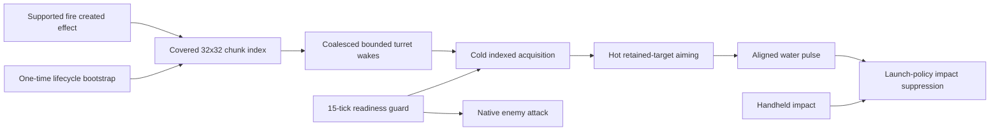

# Impact firefighting and powered water-turret service

## Implementation sources

- [firefighting.lua](../../../exotic-space-industries-remembrance/scripts/control/firefighting.lua)
- [water-turret.lua](../../../exotic-space-industries-remembrance/scripts/control/water-turret.lua)
- [firefighting-config.lua](../../../exotic-space-industries-remembrance/lib/firefighting-config.lua)
- [water-turret-fire-index.lua](../../../exotic-space-industries-remembrance/scripts/control/water-turret-fire-index.lua)
- [water-turret-fires.lua](../../../exotic-space-industries-remembrance/scripts/data-final-updates/water-turret-fires.lua)

## Ownership and behavior

`firefighting` owns impact-only removal and no persistent state. Handheld impacts deliberately remove every fire in their small square, including acid. Water impacts use explicit thermal and optional weapon-fire catalogs; their exact effect IDs encode launch-time policy. Legacy extinguisher markers are consumed on creation, while configuration cleanup removes stale markers without new impacts.

`water-turret` owns `storage.ei.water_turret`: authoritative turret/preferences/power-helper records and pulse deadlines, plus derived coverage, index, queues and search views. Native fluid-turret behavior owns enemy acquisition and combat. The relative GUI stores enemy-first, fire-first or fire-only and weapon-fire opt-in. Shared config owns identities and limits. `control.lua` remains the sole dispatcher.

## Fire discovery and exact coverage

After ESIR's fire variants exist, the final-data pass appends private `ei-water-fire-created` notifications, preserving prior `created_effect` actions. Notifications remain enabled independently of fuel adaptation. Explicit catalogs exclude acid. The notification supplies a valid entity; destruction registrations identify and deduplicate fires, which have no unit number.

The index partitions surfaces into 32x32 chunks using shared floor-coordinate helpers. Cached 8x8 cells reject births outside the exact union of ranges. Fully covered cells accept in constant time; boundary cells test cached circle geometry, separately respecting weapon opt-in. Callbacks never fan out through turret records. Many circles sharing one partial cell can still increase boundary-test cost. Chunk wakeups coalesce and visit watchers incrementally.

New coverage/categories, migration, repair and surface import seed existing fires once. Overlapping turrets share results. Expansion within a subscribed chunk invalidates its seed when cached geometry cannot prove the new area was covered; a coverage generation prevents older bootstrap results declaring expanded coverage complete. Bootstrap result ingestion shares the cold budget. There is no recurring discovery or recovery scan.

`ei-water-turret-fire-targeting` replaces the search interval. Default `first-nearby` visits chunk bounds by minimum squared distance, ties by x then y, and thermal entries before enabled weapon entries within each chunk. It stops at the first eligible, in-range fire. `nearest` searches captured arrays/tails through bounded slices, retains its best distance, and breaks ties by registration number. Later births do not restart a search; an empty finish after a newer wake schedules fresh acquisition. Both retain a valid target. No cross-turret reservations exist.

## Tick flow and work limits

Callbacks pass `event.tick`. Independently staggered power guards reschedule at +15 ticks and observe readiness changes, including dry-to-wet recovery. Current hot due buckets detach without bulk-admitting their members; FIFO batch cursors drain within the hot allowance. Phase, generation and deadline checks reject stale jobs. Each turret receives at most one aiming service per tick.

| Work | Per-tick limit |
| --- | --- |
| Hot entries, including stale work | 32 |
| Cold slices | 8 of at most 64 slots |
| Combined cold candidate/maintenance visits | 512 |
| Watcher/wake work slots | 32 |
| Lifecycle bootstrap chunk queries | 1 |

One cold slice is reserved for pending compaction. Acquisition, seed ingestion and retired-bucket cleanup share the remaining FIFO work. These limits bound service work, not total CPU time: creation bursts, power checks, impact processing and each individual bootstrap query remain separately measurable. Shared scheduler FIFO compaction is amortized.

Hot work never discovers fires. Cooldown targets sleep in delayed buckets. Dry/unavailable turrets skip acquisition. Targetless available turrets sleep until an event or observed readiness transition wakes them. Pulses consume 15 water and refund it if stream creation fails. Rebuild resolves `game.tick` only at an unticked lifecycle boundary.

## Stable views and compaction

Candidate/watcher arrays append IDs and leave tombstones on removal. Readers retain their array reference and tail. Compaction copies through bounded slices into an unpublished builder, mirrors additions/removals, then publishes by swapping arrays. Only the unpublished builder may swap-remove. Existing readers finish old views and validate current authoritative membership. A reserved cold slice prevents compaction starvation. Empty coverage buckets retire; bounded cold work releases their indexed fire entries. Coverage contraction within a still-subscribed chunk may retain older entries until destruction; exact range checks keep them ineligible to uncovered turrets.

## Backlog-aware suppression aiming

Rotation allowance is `0.02 turns * elapsed aiming ticks`, clamped to the remaining shortest wrapped arc. Acquisition initializes a checkpoint as soon as the target becomes eligible, before hot-queue waiting. Each service advances the checkpoint to its supplied tick. Backlogged turrets can skip intermediate orientations without multiplying remaining turn time; the queue may still delay the next service.

Every service rechecks target validity/range, readiness, water and enemy-first native targeting before rotation or firing. Alignment launches at most one pulse; its 60-tick cooldown begins at the actual launch tick, with no catch-up firing burst. Retained-target aiming restarts at that deadline or a later readiness resume, excluding preceding cooldown and observed pause time.

Target changes/loss, teleport, preferences, helper loss and observed inhibition clear the checkpoint. Brief transitions entirely between guards and hot services cannot be reconstructed. Only upper-assembly orientation changes; ground direction and pipe collars stay fixed. The scripted and native rotation speeds share config.

## Lifecycle and invariants

40k/30k electrical thresholds provide hysteresis. Circuit/recipe disable, freezing, deconstruction and another script's inhibit prevent suppression. `owns_inhibit` releases only a disable acquired by ESIR. Teleport rebinds/recreates the helper without carrying charge to a disconnected destination. The guard also reconciles silently moved turret geometry. Prototype and quality are immutable in 2.0.77 runtime, so range is cached during coverage setup and refreshed by build/replacement/clone, teleport and configuration/admin repair, avoiding repeated attack-parameter table materialization.

Build/removal, clone, force merge, blueprint/settings paste, surface clear/delete and rebuild maintain ownership. Surface import removes unowned imported helper copies before registering turrets. Chunk deletion retains subscriptions belonging to surviving neighboring turrets; destruction registrations remove fires. Cloned or notified-moved fires are admitted explicitly. Arbitrary silent relocation of an existing fire is outside the contract; notified movement and destroy/recreate are supported.

Clone dispatch must reach hidden helpers so copied helpers are removed. Manual and turret fire policies remain different. Native combat, impact queries, acid protection, handheld behavior, water costs and launch-policy semantics remain owned by their existing paths.

## Admin repair and saved state

`repair_runtime_state` preserves preferences, pulse deadlines, valid helpers and joules, rediscovers turrets and rebuilds only derived coverage/index/queues. Migration and explicit repair start fresh aiming clocks. Normal save/load preserves checkpoints, searches and queues; `on_load` performs no world scans or storage mutation. Rebuild closes stale relative panels.

## GUI refresh cost

Preference events retain the same-entity relative GUI root and update only changed dropdown/checkbox properties. Entity changes and legacy unnamed layouts rebuild once. `has_open_gui_session` preserves stale-panel cleanup through central routing; widget changes route by the console's parent tag. No GUI polling is added.

## Verification and maintenance

Use `scripts/invoke-water-turret-qc.ps1` and its README for pinned 2.0.77 creation coverage, final-data hooks under both fuel-adaptation settings, targeting modes, index/lifecycle tests, saved backlog, native combat and aiming. Paired performance scenes measure updater, event handlers and whole-engine timing against the same captured baseline.

The engine currently returns nil for fire cloning; the gate records that unsupported path honestly while explicit clone-event admission remains wired. Import handler testing is distinct from an actual surface export/import round trip. Per-module timing alone is not whole-engine UPS or multiplayer proof.
