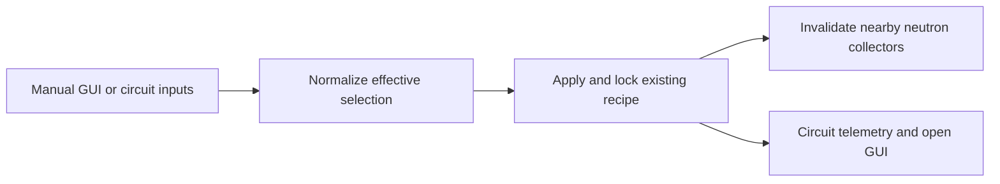

# Fusion reactor control and telemetry

## State-preserving repair

`repair_runtime_state` reconstructs dense indexes and missing wire helpers in place. Manual selection, circuit-control choice, effective recipe and live fluid/inventory contents survive; repair does not apply a new selection. Configuration changes use this same path, with a tick captured at the configuration boundary. The active recipe alone cannot recover the user's manual fallback while circuit control is active. Valid owned proxies remain in place; unowned proxies are removed after ownership is reconciled.

## Implementation sources

- [fusion-reactor.lua](../../../exotic-space-industries-remembrance/scripts/control/fusion-reactor.lua)

## Ownership and reference flow

The reactor remains a native recipe-driven machine. `storage.ei.fusion_reactor` owns reactor records, indexed service order, manual/effective selections, control-source mode, wire proxies, and open players. Selection normalization maps fuel pair, temperature, and injection mode onto an existing recipe.

## Tick flow and invariants

The staggered dispatcher supplies a budget/event to `update`; service walks the reactor index with a persistent cursor. Build and GUI recipe updates accept an event or numeric tick, with `game.tick` fallback for context-free callers. Preserve manual selections when circuit control supplies effective values, and only notify neutron collectors when the native recipe changes. Telemetry output must not be mistaken for external circuit input.

## Lifecycle and cleanup

Init and explicit full rebuild reconstruct reactor entries from current world recipes. Configuration changes instead retain saved reactor records, manual fallback selections, control-source choices, open-player ownership and valid wire helpers. Build registers and services immediately; settings paste carries control settings through normalization. Destruction removes registry membership, proxy, and affected GUI sessions. The dense service index swaps its last unit into a removed slot, updates that unit's reverse index and bounds the cursor; removing the last reactor leaves zero pending work. Repair replaces missing helpers and removes unowned helpers without changing a working recipe or its fluids.

## GUI refresh ownership

`open_by_player` remains the viewer owner. Reactor service supplies its existing entry to viewers, avoiding registration/recipe discovery per viewer. GUI writes depend on normalized effective/manual selections, control source and wire state; identical state leaves sliders and fuel controls untouched. Local render snapshots are disposable and close/leave clears them. Reconcile an existing console on player join so a saved window resumes subscriptions. Recipe, collector and circuit service behavior is unchanged.

The translated control-source explanation wraps within 340 UI pixels, leaving room for the scroll bar so the console does not grow to the full sentence width beside the native machine and circuit panels. Text and localized meaning are unchanged.

The body sits in a vertical scroll pane capped against the player's display height
and UI scale. This keeps the five Options buttons and five read-only agent values
reachable when the native relative panel would otherwise clip lower descendants.
Serialized consoles using the old body structure are rebuilt on reconciliation;
reactor selections and viewer ownership still come from the existing runtime state.

Below 1,600 UI-scaled pixels of display width, the console uses a draggable screen
frame instead of a right-hand relative anchor. This keeps it inside the viewport
when the native machine and expanded circuit panels occupy the available width.
The native opened entity remains the owner; the fallback does not replace it with
a GUI element. Closing the entity tears down either root, and the fallback also
has an explicit close button. A viewer refresh adopts the appropriate surface
after resolution or scale changes. No control values or reactor settings change.
The fallback is raised once after native entity opening settles, using the existing
viewer refresh. Later updates do not repeatedly take focus from other windows.

## Verification contract

Test manual/circuit transitions, absent or partial circuit signals, recipe changes observed by neutron collectors, copy/paste, proxy destruction, open-console removal, and configuration repair. Use runtime QC and inspect both recipe identity and circuit outputs.

The 2.1 upgrade's private `stage_fusion.py` suite records 135 native recipe cases on each engine (1,053 assertions each), 121 preserved fields across actual 2.0-to-2.1 migration and a second save/reload, and 20 native lifecycle/circuit/collector assertions. The recipe comparison preserves consumption, yields, capacity and completion timing exactly after normalizing the API's renamed probability representation. The migration negative receipt exposed lost manual fallbacks and proxy replacement; the lifecycle negative receipt exposed stale service-index membership. Both fixes have passing native receipts. See [upgrade synopsis](../handoffs/factorio-2.1/UPGRADE_SYNOPSIS.md) for evidence boundaries, graphical-console acceptance and release status.
