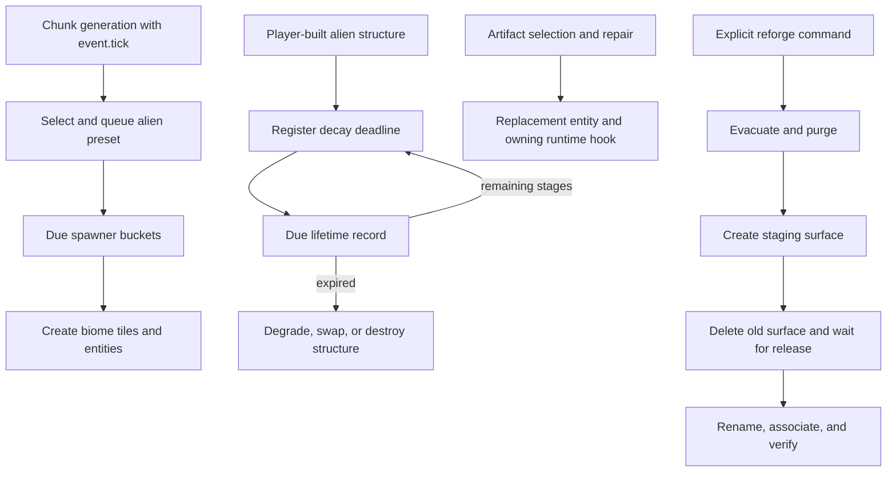

# Gaia surfaces, alien presets, and artifact progression

## Admin repair

Gaia and alien-spawner `repair_runtime_state` normalize delayed work and recalculate due minima without recreating surfaces, replaying chunks, restarting decay lifetimes or resetting legendary history. Alien-system repair preserves per-force currency/unlocks and closes stale confirmation screens.

## Implementation sources

Authored preset placement notifies the configured terrain-protection callback
before either placement phase. Bounds are retained conservatively; surviving
artifact anchors classify legacy sites through budgeted ecology searches.

- [gaia.lua](../../../exotic-space-industries-remembrance/scripts/control/gaia.lua)
- [gaia-mapgen-data.lua](../../../exotic-space-industries-remembrance/scripts/control/gaia-mapgen-data.lua)
- [alien-system.lua](../../../exotic-space-industries-remembrance/scripts/control/alien-system.lua)
- [alien-spawner.lua](../../../exotic-space-industries-remembrance/scripts/control/alien-spawner.lua)
- [spawner-presets.lua](../../../exotic-space-industries-remembrance/lib/spawner-presets.lua)
- [biomes.lua](../../../exotic-space-industries-remembrance/prototypes/planet-gaia/biomes.lua)
- [1.3.03.lua](../../../exotic-space-industries-remembrance/migrations/1.3.03.lua)
- [1.3.39.lua](../../../exotic-space-industries-remembrance/migrations/1.3.39.lua)

## Behavior and ownership

Three cooperating owners remain distinct. `gaia` manages the Gaia planet/surface association, explicit reforge state machine, and decay of registered alien structures. `alien-spawner` creates biome-aware presets, guardians, and delayed chunk work. `alien-system` manages per-force alien currency/unlocks, confirmation UI, and artifact repair. `gaia-mapgen-data`, `spawner-presets`, and the shared biome tables supply configuration/data rather than event registration.

State roots are `storage.ei.reforge_gaia`, `damage_tick_buckets`/`damage_tick_next_due_tick`, `spawner_buckets`/`spawner_next_due_tick`, flower/legendary spawn records, and `storage.ei.alien[force.name]`. `storage.gaia_surfaces` is the compatibility surface registry, shared with the integration interface.

## System invariants and interactions

`ensure_surface` and `migrate_gaia_surface` reconcile the actual planet association and legacy surface names. Reforge is an explicit destructive operation; ordinary initialization must not replay it. `reforge_gaia_surface` requires the planet and a safe return surface and refuses to start another run while state exists. `reforge_on_tick` advances `migrate_legacy → check_intact → evacuate → purge → stage_surface → queue_delete → wait_for_release → rename_and_bind → verify`, with completion/failure handling and retry bounds. Preserve the staging/association sequence instead of renaming the legacy planet blindly.

`alien-spawner.on_chunk_generated` schedules a preset for the next tick on an allowed surface. `update` drains due work and currently discards jobs more than ten ticks overdue; this age cutoff is gameplay policy, not a generic scheduler behavior. Preset/biome helpers preserve themed tree/tile choices. Legendary completion is recorded only at the appropriate entity-spawn phase. Destruction of eligible untouched alien structures may trigger guardians.

`gaia.register_entity` tracks supported structures with a last-user requirement unless explicitly overloaded. `update_entity_lifetimes` revalidates each queued entity, reduces its remaining stage value, displays that value, and eventually degrades the building.

### Artifact repair

Artifact repair preserves force, position and quality, removes the selected original only after a valid replacement exists, consumes the cursor tool, calls the crystal runtime's repair hook when present, and increments victory statistics. Invalid selection entries are skipped; failed creation leaves the ruin and tool intact.

Repaired alien beacons raise exactly one native `script_raised_built` event after removing the ruin. Nonstandard Beacons 1.4.2 listens to that event to create its source/manager and metadata; silently creating a beacon leaves its hover-status handler without metadata. ESIR uses the standard event rather than writing dependency-owned storage or calling its migration interface. The replacement is revalidated before the later crystal hook because build-event listeners may invalidate it. Crystal and farstation repairs retain their existing notification behavior.

Alien purchases use force-name-owned currency/unlock state and a confirmation GUI. The current confirmation handler consumes the nested tags' cost/name; it does not repeat every eligibility test made when opening confirmation. Do not claim the UI already provides a general transactional/concurrent-purchase guarantee.

## Tick flow

Chunk work derives deadlines from `event.tick + 1`; lifetime registration derives its deadline from `event.tick + entity_damage_ticks[name]`. Both due queues catch up through the service tick and use derived earliest-due guards. Gaia reforge runs in coordinator slot one; damage and spawner drains run in the mandatory tier only when due. Pass the supplied tick through reforge phases and delayed work. Existing status or explicit no-event entrypoints use current-clock fallbacks; ordinary events already carry the authoritative tick.

## Lifecycle and upgrades

The [planetary enemy contract](planet-enemies.md#gaia) adds an independent Gaia
electric control. Legacy values, including Off, translate without resetting them.
Fallback creation inherits save choices; reforge captures source settings before
purge/deletion, retaining controls, seed and global peace/no-enemies flags. The
final planet prototype provides the current dependency expression aliases.
The [map-settings owner](map-settings.md#lifecycle) merges saved sparse overrides
before fallback or reforge staging creates chunks. The ready callback receives the
originating tick and reapplies the latest override revision after association, so
changes made while reforge runs survive. This owner remains active with admin tools Off.

Old flat decay/spawner queues are normalized into bucket structures by the owning modules. Configuration handling invalidates derived due minima so persisted work remains discoverable. Missing/invalid entities are skipped at lifetime consumption; surface deletion/rebinding must also account for queued surface references and feature-owned helpers.

Migration `1.3.03` associates the existing legacy Gaia surface when the current planet lacks one; it does not rename the legacy space location. Migration `1.3.39` removes exact legacy resource overrides and preserves customized settings/nonmatching overrides. Its map-generation changes affect future chunks, not regeneration of existing terrain. Keep ordinary migration repair separate from the intentional reforge command.

The optional admin observer is installed through `set_surface_ready_handler` at
control load. Gaia invokes it only after association, distinguishing new creation
and reforge from rebinding an existing legacy surface. This preserves explicit
planet policies through staging and lets the default peaceful setting affect new
surfaces without changing existing ones. The observer creates no independent
scheduler and Gaia retains its creation/reforge ownership.

## Verification and limits

The [Gaia resource QC guide](../../skills/esir-dev/references/gaia-resource-qc.md) documents native multi-seed/resource-control probes. The [queue lifecycle fixture](../../../scripts/qc/control-ups/queue-save.lua) and [driver](../../../scripts/invoke-control-lifecycle-qc.ps1) provide persisted delayed-work checks.

The [alien beacon repair fixture](../../../scripts/qc/alien-beacon-repair/README.md) reproduces the Nonstandard Beacons 1.4.2 line-556 hover crash on the pre-fix source. On Factorio 2.0.77, the repaired path passed 115 assertions across three damaged variants at normal and legendary quality, including native hover callbacks, cursor consumption, metadata, fuel, activation and removal. This is focused engine evidence, not rendered UI or multiplayer acceptance.

Verify legacy association, custom mapgen preservation, due queue migration, stale entities, preset aging/legendary completion, artifact quality and crystal re-registration, and every reforge transition with players and existing surfaces. Resource-preview success does not prove reforge safety, artifact GUI behavior, geographic distribution, or multiplayer parity. The beacon fixture covers only beacon repairs; the remaining paths require their own engine acceptance.

## Rebuild activity reporting

Gaia reforge carries a report ID and publishes phase, elapsed ticks and explicit wait reason at existing state-machine boundaries. There is no common denominator. Completion/failure close the generation; owner-confirmed external waits remain in Diagnostics and disappear publicly.
