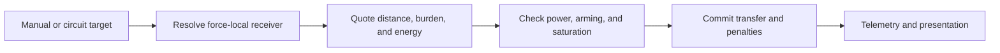

# Gate transport and receiver selection

## Implementation sources

- [gate.lua](../../../exotic-space-industries-remembrance/scripts/control/gate.lua)
- [gate-calculations.lua](../../../exotic-space-industries-remembrance/lib/gate-calculations.lua)
- [gate-projection.lua](../../../exotic-space-industries-remembrance/lib/gate-projection.lua)
- [gate-estimator-chart.lua](../../../exotic-space-industries-remembrance/lib/gate-estimator-chart.lua)
- [gate-estimator.lua](../../../exotic-space-industries-remembrance/scripts/control/gate-estimator.lua)

## Ownership and reference flow

`storage.ei.gate` owns sender/container pairs, receiver IDs and lookup state, selector sessions, wire proxies, stress/saturation, render handles, and the sender service cursor. Distance quotations use the shared surface-anchor helper; item transport preserves item/quality identity.

## Tick flow and invariants

Dispatcher step 7 passes the event to bounded sender service. Receiver refresh and GUI housekeeping run once per supplied tick even when the dispatcher requests multiple units. The current module still contains a direct `game.tick` read in permission restoration; it is a documented audit point, not proof of event-tick compliance. Keep quotation separate from payment and preserve elapsed-time penalty decay.

## Lifecycle and cleanup

Build/destroy hooks register sender/container/receiver relationships. Receiver changes invalidate target resolution; sender destruction removes proxies, render state, and remote-selection ownership. GUI/area/cursor events drive manual destination selection, and player departure closes it. Init/configuration rebuild repairs registries and cached distance data. Unit-number changes must update every registry and GUI tag.

## Sender quality and energy

The registered visible sender container owns quality; the hidden energy store does not. Read its level on demand, defaulting to zero when unavailable and clamping negative levels to zero. The energy multiplier is `1 / (1 + 0.2 * level)`, including modded levels. No persistent efficiency state or helper replacement is needed for existing saves.

`quote_transfer(entries, source_surface, target_surface, gate)` records the multiplier and floors the final burden/distance/quality product once. Omitting the optional sender preserves undiscounted quotes. Live transfers, partial-transfer requotes and the compatibility payment helper supply the sender. Affordability and payment consume the same quote. Cargo and receiver quality do not affect cost; stress, saturation, residue and cooldown remain tied to existing physical-burden rules.

Both reported instantaneous upkeep and elapsed-time drain apply this multiplier to armed, stress and cooldown energy. Preserve the existing operating threshold, stress integration and cooldown-overlap timing. The console displays the energy-cost percentage and includes the multiplier in its projection signature; older GUI roots rebuild when the new label is absent. Buffers, charging limits and player travel policy do not change.

## Input cooldown and console countdown

Disabled, unresolved, underpowered and cooling senders close their native inventory bar to automated input. A successful cargo transfer closes the bar in the same callback, after residue placement. Existing cargo remains accessible and manual insertion retains native barred-slot behavior. Receiver saturation alone pauses transfer without closing input. Circuit arming remains independent of cooldown.

The existing bounded sender service reopens input on its first visit at or after the cooldown deadline, provided no inactive-state condition remains. No additional timer or scan owns this transition. Init/configuration repair refreshes the lock from the preserved deadline.

The console derives remaining ticks from `max(0, cooldown_until_tick - event.tick)` and rounds upward to tenths of a game-time second. Cooling takes precedence over Critical, even while disabled or underpowered. At expiry the existing Stable/Critical status returns; this does not guarantee transport readiness. The displayed countdown participates in the GUI projection signature and updates only through existing open-console refreshes. It adds no persistent duration/start field.

Runtime occupies a fixed 480-by-40 logical-pixel, wrapping label in the Status section. The reserved two-line area stays the same size for Stable, Critical and every countdown length, isolating it from the destination/camera columns. Cached consoles with Runtime in the old target column are invalidated and rebuilt through the existing GUI lifecycle. Locale keys and countdown semantics are unchanged.

The destination camera and its frame stretch across the remaining Control section width and the full control-column height, with a 222-pixel minimum preview on each axis. Its zoom remains 0.25; the larger viewport shows more of the destination. Cached fixed-size camera consoles rebuild through the same GUI validity check.

Cooldown coverage extends the gate-quality fixture with immediate locking, real inserter blocking and recovery, retained/removable cargo, inactive and saturated controls, supplied-tick countdown boundaries, native GUI captions and serialized cooldown state. Rendered captures establish layout separately from native GUI assertions.

## Detached estimator

The console launcher opens one nonmodal screen calculator per player, without assigning `player.opened`. `storage.ei_gate_estimator` owns drafts, one pinned baseline, GUI sessions, rendered chart handles and resumable projection jobs. Closing the entity console leaves the calculator open; source destruction only prevents further snapshot reads. Close/disconnect cancels jobs and removes render objects, while drafts and baseline survive. Reload/configuration rebuild open windows on the first admitted tick and invalidate projections. No estimator operation changes a real gate's energy, cargo or settings.

`gate-calculations` owns pure burden energy, distance/quality scaling, quote, post-transfer and elapsed upkeep arithmetic. Live gate entry points remain compatible wrappers. The mass table remains authoritative in the gate owner. Planet pairs use the existing anchor cache without generating surfaces; identical selected planets mean the same surface. Manual presets preserve local, orbital, interplanetary and unresolved pricing. Platform routes are fixed snapshots.

The projection simulates one item with empty input/upstream inventories, a valid enabled route, native buffer/charging limits and constant supply. Input deposits are capped by the selected quantity each simulated tick; native stacks can merge and transfer without waiting to fill. Input remains closed until serviced after cooldown; saturation alone allows buffering. Affordability never splits a stack. Receiver output and residue are automatically cleared; competing senders, spoilage, circuit changes, inserter motion and moving routes are excluded. Stress/upkeep use the live elapsed-service calculation; receiver decay is on the sixteen-tick receiver cadence. Sender service uses a fixed `16 * ceil(gate_count / budget)` snapshot, with the same budget calculation as central dispatch.

Run explicitly admits work through the shared scheduler queue: at most ten 100-tick slices (1,000 simulated ticks) globally per game tick. Edits cancel obsolete work and mark old plots stale; completed/closed sessions do no recurring simulation. Each scenario retains at most 240 bins with extrema and integrated throughput/energy totals. The maximum horizon is 60 game-time minutes. Waiting causes overlap and are not an additive time partition.

Two selectable camera charts render into the bounded, force-hidden `ei-gate-estimator-chart` surface, which has no entities or planetary anchor. Objects are restricted to the viewer and destroyed on close/rebuild. The empty canvas is reused. No gameplay surface is generated by planet selection. Ordinary surface pickers and ecology census exclude the internal canvas.

Chart camera zoom fits the 24-tile canvas to the widget's physical width: logical width times the player's display scale. Camera content does not inherit interface scaling. The existing display-change rebuild refits both plots; no polling or simulation rerun is needed.

The Calculation tab shows substituted equations and per-item transfer energy excluding upkeep. Quotes refresh on edits; graphs retain the last explicit run. Current and baseline share chart scales and horizon, with solid/dashed curves. Hidden quality prototypes never appear in the selector, except Normal which base hides when Quality is disabled. Pinned inputs are revalidated against current item, quality and planet prototypes before running; unavailable prototypes require replacing or clearing the baseline. Tooltips, assumptions and all new controls are localized in all eight supported locales. Window sizing responds to native resolution/scale events rather than polling.

Estimator coverage uses test-suite: gate-quality; test-case: gate-quality/candidate; test-case: gate-quality/reload; test-case: gate-quality/configuration. Pure deterministic/conservation assertions, native quotation parity and native GUI lifecycle assertions are distinct from rendered chart/locale inspection and multiplayer evidence.

## Verification contract

Registered coverage: test-suite: gate-quality; test-case: gate-quality/candidate; test-case: gate-quality/reload; test-case: gate-quality/configuration. The private fixture checks sender tiers, exact tolls, partial cargo, upkeep timing, helper repair and save persistence. Rendered GUI and multiplayer acceptance remain separate.

Test same/cross-surface transfer, quality-bearing items, unavailable/full receivers, insufficient energy, saturation, circuit changes, target deletion, cancelled remote selection, player cleanup, and reload. Compare transferred contents and charged energy. Preserve native transport policy while modifying documentation or tick plumbing.

## Native warning and source control

The gate owns one `gate-low-power` condition in the [shared alert handler](runtime-alerts.md#contract), keyed by sender unit number and targeted at the visible container. Both power paths evaluate effective manual/circuit enablement and the existing 100 GJ threshold. Recovery, disablement, removal or `alerts_enabled=false` clears it. Missing source preferences default On; saved Off survives registry rebuilds, while new/blueprint/clone records start On. The checkbox beneath enable validates tags, identity and force access, participates in projection caching, and refreshes other open consoles. Personal type and category settings remain mandatory.
