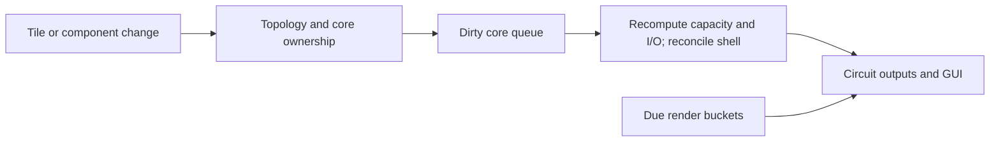

# Induction matrix topology and power

## Implementation sources

- [induction-matrix.lua](../../../exotic-space-industries-remembrance/scripts/control/induction-matrix.lua)
- [matrix prototypes](../../../exotic-space-industries-remembrance/prototypes/computer-age/induction-matrix.lua)

## Ownership and reference flow

`storage.ei.induction_matrix` owns logical core records, topology-derived stats, dirty-core queues, deferred removals, wire-proxy reverse mappings, render buckets, and telemetry service slots. Tile/entity hooks discover connected matrix topology and mark affected cores dirty.

## Tick flow and invariants

The main dispatcher calls the gated local `update(event)` each tick. It processes render deadlines, dirty matrices, and scheduled wire outputs; open GUI refresh is gated to every 15 ticks. Event ticks also drive temporary topology/stat render expiration. `has_tick_work` has a context-free fallback. Preserve core-ID remapping across shell swaps, stored power when applying changed capacity/I/O, and external circuit connections; do not recompute whole topology on every ordinary tick.

## Lifecycle and cleanup

Build/destroy/tile replacement can split, merge, or invalidate matrix membership. Duplicate cores and old IDs require explicit reconciliation, including GUI tags and proxy mappings. Init/configuration reconciliation repairs settings, circuit outputs, and GUI viewers; explicit `rebuild_runtime_state` / `/rescan_induction_matrix` rebuilds live topology and scheduler metadata. Deferred renders and invalid cores must be cleaned even after the last ordinary component is removed.

## GUI refresh ownership

`storage.ei.induction_matrix_gui_by_player` records current viewers separately from resettable matrix topology. Open/close, joined/left/removed-player hooks and configuration reconciliation own membership; only the one-time reconciliation scans connected players. Existing 15-tick live energy display visits registered viewers and shares each matrix's snapshot. Core retags update viewer identity; invalid cores close the console; camera surface/position follows the current core. Captions and progress values write only on change; topology and native energy simulation retain their existing cadence.

## Circuit settings and transfer

Each logical core owns `circuit_settings` (version 1), with `enabled` and optional
`SignalID` fields for `charge`, `capacity`, `max_io`, and `percent`. All outputs
default off, with C/T/M selected for MJ/MJ/MW and A for percentage. Existing saved
choices remain authoritative; missing settings migrate to all off. An empty picker suppresses
output without losing the checkbox state. Percentage rounds unrounded energy /
capacity to the nearest integer in 0-100; zero capacity yields zero. Existing
MJ/MW rounding and signed integer limits remain unchanged. Identical signal
type/name/quality assignments are summed and clamped before writing unique slots.

The hidden constant-combinator proxy is derived output only. Its four slots use a
single private, active section with multiplier one. Explicit settings changes and
native settings paste rebuild even unwired proxies immediately; scheduled updates
retain the wired-only, staggered 60-tick cadence and skip unchanged values/settings.
Matrices with no enabled, selected output have no telemetry slot and their proxy
control behavior is disabled. Explicit edits still clear old filters immediately
without reading energy for telemetry when turning the last output off. Settings changes and
configuration repair invalidate slot membership. Closed, idle matrices admit no
tick work; active telemetry admits only its due slot, while dirty/render/GUI work
retains its existing lifecycle and cadence.
Both connected wire colors receive the same outputs. Settings paste detaches shared
groups before clearing copied filters and restores destination measurements, never
source readings. Non-matrix paste keeps the destination configuration.

`reset_matrix_table` preserves settings through topology analysis; shell replacement
moves the entire record. Full repair snapshots settings by core identity before
resetting topology, including dormant cores without floor tiles. Duplicate-core
resolution keeps the selected survivor's configuration. Signal copies validate all
native signal types and qualities against live prototypes; removed signals become
empty selectors. No runtime state is mutated during `on_load`.

`control.lua` owns checkbox/picker, settings-paste, clone, and blueprint dispatch.
Blueprint capture tags real cores with `ei_induction_matrix` before any handler
rewrites blueprint entities. Build/revival and clone paths seed settings before
flood-fill. Helper clones are adopted in either order; provisional helpers transfer
their wire peers before removal. Proxy-first clones stay disabled until their core
arrives; explicit repair removes unmatched orphan helpers.

The screen console adds a right-hand circuit panel with red/green network IDs and
four checkbox/picker rows. Existing viewer refresh shares readings, writes changed
widgets only, and follows remapped core IDs. Saved roots without circuit GUI version
1 are rebuilt at their prior position. All custom text and updated circuit help
exist in en/de/fr/ja/pl/ru/zh-CN/zh-TW; built-in headings use native Factorio locale.

## Verification contract

Use [control UPS fixture](../../../scripts/qc/control-ups/README.md) and the [follow-up lifecycle record](../../../scripts/qc/control-ups/followup-verification.md) as historical guidance. Test split/merge, duplicate cores, last-tile removal, shell upgrade/downgrade, saved energy, wire reconnection, delayed render expiry, and open-GUI destruction. Headless session tests are not a substitute for visual review.

The [circuit acceptance fixture](../../../scripts/qc/induction-circuit/README.md)
exercises the signal contract, native transfer paths, saved GUI repair, and all eight
locale/scale renders. Its verification record distinguishes runtime assertions,
rendered text/layout, native mouse interaction, and multiplayer evidence.
