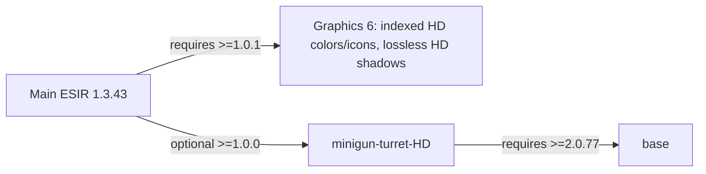

# Minigun turret separated native graphics

## Implementation sources

- [gatling-turret.lua](../../../exotic-space-industries-remembrance/prototypes/electricity-age/gatling-turret.lua)
- [graphics.lua](../../../exotic-space-industries-remembrance/prototypes/electricity-age/gatling-turret/graphics.lua)
- [graphics-data.lua](../../../exotic-space-industries-remembrance/prototypes/electricity-age/gatling-turret/graphics-data.lua)
- [HD graphics library](../../../minigun-turret-HD/lib/graphics.lua)
- [Standalone turret](../../../minigun-turret-HD/prototypes/minigun-turret.lua)
- [Standalone research bonuses](../../../minigun-turret-HD/data-final-fixes.lua)

The original geometry owner comes from the evidence-bound finalizer. The
[indexed HD derivative](../asset-generators/minigun-turret/INDEXED-HD.md) reuses
that geometry with separate quantization and native receipts. Install matching
metadata and asset families together; do not treat lossy pixels as original
lossless-finalizer output.

## Scope and integration status

The replacement passed native color, shadow and firing alignment checks. The
standalone extension passed base-only, Space Age and main-plus-HD data loads,
the short firing/GUI check, locale coverage and exact ZIP integrity/byte checks.
The finished ZIPs are staged for later installation; no live installation changed.
The durable [generation handoff](../asset-generators/minigun-turret/HANDOFF-SEPARATED.md)
owns source provenance, rig measurements, exact motion equations and production
gates. Historical rig and timing evidence remains unchanged.
Resume work from [the current operational status](../../../output/minigun-implementation/STATUS.md)
and [live render snapshot](../../../output/minigun-implementation/render-status.json).
These locate the active production render and installed tooling without treating
the earlier progress snapshot as a current remaining-work count.

The turret definition retains gameplay ownership. The graphics module builds
native tables from generated atlas metadata and selects the enabled texture
profile. Factorio owns aiming, state changes and animation playback. The change
adds no runtime handler, scheduler, storage, migration or public setting.
Preserve the existing 3x3 selection and 2.8x2.8 collision footprint, attack
payload, cadence, ammo/energy consumption, rotation and range behavior.

## Mechanical layers and generated authority

The pedestal remains fixed in world orientation. Receiver, cradle, rear drum and
stationary receiver collars yaw around the bearing. The barrel cluster and its
forward collars spin about the bore beneath that yaw. The inspected source has
five main bores and irregular smaller details; no reduced angular period may be
inferred from a regular six-barrel model.

Each mechanical layer has its own color family. The selected ground-shadow
representation is a complete all-caster mask for each direction and physical
pose, separately at SD and HD density. Base/upper shadow passes remain source
evidence; failed residual decomposition is not part of this candidate. Generated metadata
owns exact image paths, dimensions, stable crops, shifts and pose maps. The
factories apply the shared presentation offset described below to copied leaves
and launch coordinates; source metadata keeps its original render registration.
The renderer and native tables share 256 directions with yaw `-360*d/256`, index
`d=0..255`, canonical forward `+Y`. The original SD32 scale 1 and HD64 scale 0.5
sources preserve the same world size. Both current profiles use HD64 scale 0.5;
the default applies one shared 256-entry RGBA palette without dithering. Original
lossless base, upper and rotor recomposition matches the assembled reference;
the derivative separately checks quantization, occlusion and seam behavior. No pitch, recoil,
deployment, glow or force-color layer is introduced.

The rotor correction may be stored as four vertical spatial strips, each a
native color leaf with all 256 directions and 28 poses. This is storage for one
mechanical rotor, with ordinary source-over blending and crop-derived child
shifts. Exact center-pixel reconstruction and native fractional/zoom comparisons
must both pass; no assumed seam safety follows from cutting an RGBA frame.
Atlas dimensions remain bounded by 4096 pixels.

## Placement-box registration

The visible foundation's alpha-bounds midpoint is approximately 5.5 standard
pixels north of the entity position. The actual contact footprint is only about
1.67 pixels north; most apparent bias comes from the rendered base's height.
Both graphics factories lower the complete assembly by `6/32` screen-space tiles
(six SD pixels, twelve HD source pixels) to center the visible foundation.
This is a presentation adjustment, not a new ground anchor or collision box.

Apply the offset once to every copied foundation, upper, rotor and shadow leaf,
and to the Y coordinate of all 256 copied launch-map entries. Leave their X
coordinates, direction indices, native launch fields and casing-relative offsets
unchanged. Reapplying a factory must not accumulate the offset. Source atlas
metadata, PNGs, item/research icons and the 3x3 selection box remain unchanged.
The short native before/after fixture covers both densities at cardinal headings;
the original full-direction firing evidence remains the relative-alignment basis.

## Native animation state

The 28 physical rotor poses are: sharp parked P at index 1; centered 90-degree
blurred running R at index 2; ten spin-up interior poses at indices 3..12; and
sixteen spin-down interior poses at indices 13..28. Logical spin-up is 12 frames
`{1,3,4,5,6,7,8,9,10,11,12,2}`. Logical spin-down is 18 frames
`{2,13,14,15,16,17,18,19,20,21,22,23,24,25,26,27,28,1}`.

P and R endpoints reuse identical physical color and shadow bytes. Interior
motion follows the handoff's acceleration/deceleration equations through a
centered one-frame shutter. Running is the approved 90-degree blur appearance;
do not alter shot cadence to drive a rotor cycle. Every state has its matching
shadow rather than a parked shadow approximation. Native start/stop, interruption
and save/load behavior must pass the focused engine gate before acceptance.

## Enabled texture profile and dependency boundary

Main ESIR 1.3.43 requires Graphics 6 >= 1.0.1. Graphics 6 owns all indexed HD64
base/upper/rotor colors, indexed HD icons and unchanged complete HD shadows.
The `sd` metadata key is retained as the default-package slot, not a density.
The old 84-file SD set and layout are protected in the minigun holding dossier.
Graphics 4 and 5 retain
their existing 1.0.0 content and receive no new minigun assets.
Each file contains whole contiguous direction groups and all 28 physical poses.
Its direction capacity comes from generated profile metadata; neither 32 files
nor eight directions per file is a fixed contract. Each child's ordered native
`filenames` array stays inside Graphics 6 with unchanged density, crop and shift.
`minigun-turret-HD` 1.0.0 requires base >= 2.0.77 and optionally Space Age
>= 2.0.77. Main's first optional dependency is that HD pack >= 1.0.0; HD has
no reverse main dependency, avoiding a cycle. Main imports no HD Lua.
With main enabled, HD adds no gameplay prototypes. Otherwise it defines
`minigun-turret-hd` as an electric ammo turret, item, recipe and technology.
Base games use chemical-tier research; Space Age uses metallurgic research
and tungsten. Bullet damage stays at multiplier 1. The original native turret
fires one shot per tick despite its nominal 0.25 cooldown. Standalone cooldown
is 1 / 0.9: measured 54 shots versus the original's 60 in a 60-tick steady window,
with equal piercing-round damage (8). Keep attacking_speed 20; a tested 0.9
animation speed instead produced 30 shots and was rejected. Both modes use the same native graphics
library and calibrated launch map. No runtime animation handler is added.
Main metadata selects assets using enabled-mod presence from `mods`; HD absent
or disabled selects the complete indexed HD family in Graphics 6.

Every Graphics 6 filename and icon in the main generated Lua is derived from
`ei_graphics_6_path`, initialized by `lib/paths.lua` before prototype loading.
The derivative copies the finalized HD layout into the default slot and changes
only its namespace. Centering and all calibrated launch fields remain unchanged.
The original finalizer/PNG evidence stays immutable; derivative receipts identify
the quantized pixels separately. The standalone HD library retains its own root.

Enabled HD selects all HD64 colors and HD icons. Its fixed major-1 profile
provides the complete combined HD shadow family: the measured complete archive
fits below 256,000,000 bytes. The selected default also retains all HD shadows;
SD is now a retained source backup rather than a shipping shadow fallback.
Any future fallback needs its own native/budget qualification. Failed residual masks cannot supply a
partial-family fallback. Do not mix resolutions across directions or states. Freeze the
major-1 path and shadow-tier contract after measurement. An unsupported HD major
must fail clearly instead of silently using potentially incompatible metadata.

Each whole Graphics 6 and HD ZIP must be less than 256,000,000 bytes;
240,000,000 is a warning only. The cap applies independently, including each
pack's existing assets, license, reuse README and unloaded example metadata.
Pilot projections are not final whole-ZIP measurements. If a pack cannot fit
after lossless optimization, stop and report
the constraint rather than drop directions, poses, shadows or visible color.
Legacy Graphics 3 files remain unchanged for older ESIR releases. Only texture
paths and icon presentation vary with the HD profile; normalized gameplay must
be equal across absent, disabled and enabled HD configurations.

The HD pack keeps GPL-3.0-or-later and attribution, and documents independent
reuse by other mods. Its example factory/prototype and generated profile module
remain under `examples/`, never loaded by a root data.lua. The example requires
full and calibrated metadata; a pilot cannot be advertised as a usable release.
Complete SD fallback shadows, if selected, require Graphics 6 or the example
must omit the entire shadow representation. No partial shadow-family fallback.

Item and research icons use the selected model's sharp parked front three-quarter
view, with barrels visible. The turret recipe inherits its main product icon.
The separate `ei-minigun` handheld weapon, recipe and research retain their art.

## Firing alignment authority

Generate muzzle projection from the accepted model, bearing, camera and direction
convention. The legacy 64-entry exit array does not establish alignment for the
new 256-direction artwork. Check the actual native flash and projectile origins
at cardinal, diagonal and fine intermediate angles, with Ballistic Divergence
both enabled and disabled. A mismatch blocks production/promotion even when
separated renders or static projections appear correct.

Production construction rejects draft metadata. The generated table must carry
the finalizer's ready-for-staged-integration receipt, complete ordered direction
provenance, calibrated muzzle flags and exact 256-entry launch map. This gate
does not require `production_promoted=true`: integrated engine and whole-ZIP
acceptance still follow finalization. Receipt hashes are verified by the
finalizer/integration workflow; Lua shape checks are not a cryptographic audit.
Explicit fixture construction may use uncalibrated metadata and fewer actual
render directions while retaining all 256 launch tuples.

`graphics.apply` copies the tested map and adds the common presentation offset
without projection, interpolation or rounding. Its `native_launch_contract`
separately records `present` and `value`
for `projectile_center`, `projectile_creation_distance`, and
`apply_projection_to_projectile_creation_position`. Absent fields become nil;
present false/zero values remain false/zero. This preserves the effective native
launch contract rather than substituting assumed engine defaults. A fixture
without this contract retains its donor's three launch fields for calibration.
The factory owns only these launch fields and the visual state/timing tables;
the turret definition retains native attacking speed 20, cooldown, damage
bonuses, shell particles, connector, ranges and ammunition behavior. The user
owns connector placement and it is unchanged by this integration.

## Native receiver casing ejection

The gameplay owner copies vanilla `shell-particle` into a turret-specific
optimized particle. Only its name, 240-tick lifetime, 60-tick fade and 0.6 ground
movement modifier change. The standalone copy is registered only without main;
other weapons keep their existing particle definition. No runtime handler or
persistent casing entities are introduced.

The designated outlet is canonical `(0.43,-0.85,1.65)` on the gun-right receiver
lip, behind the cradle arm and forward of the rear drum. It belongs to the yawing
upper, independently of rotor phase. Native shell offsets start at the calibrated
launch reference. Distance `3.331004451991`, orientation `0.482194244912` and
particle height `0.918880365094` move that reference back to the receiver. These
values depend on the approved launch map and common SD/HD registration; changing
either requires recalibrating the outlet. `use_source_position=false` is explicit:
the true-mode probe crashes installed 2.0.77 shooting logic for this ammo turret.

Direction `105/360`, deviation `0.025`, speed `0.06` with deviation `0.008`,
vertical speed `0.01` and tumble `0.2` with deviation `0.04` produce a short
right/rear discharge, a fall and a brief slide. Native shots emit the particles;
spinning without shots emits none. The graphics factory continues to own only
graphics, native transitions and launch fields. Main and standalone gameplay
definitions carry matching casing values, except their private particle names.

The focused basis probe found all eight receiver origins within 1.25 SD pixels,
including native aiming/quantization. Actual casing bursts and a still-colored
flight marker provide the short native acceptance evidence. Preserve all 256
launch tuples, combat rates and production PNGs. The durable
[casing handoff](../asset-generators/minigun-turret/CASING-EJECTION.md) records
geometry, reproducible fixtures, scoped package lineage and review evidence.

## Verification and evidence limits

The four-strip camera-v3 full pilot passed 7,168 comparisons plus a blank control
with zero RGB error. Actual requested fractional cameras remain mandatory;
aliased images require exact native screen-translation evidence and nonzero
movement. The emitter rechecks each alias against its named case and rejects
pilot evidence as final256 production eligibility. Final color canaries include
file/direction boundaries and all28 poses in both densities at four offsets and
zooms, plus exact offline reconstruction of all7,168 cells per density.

Native default texture compression changes separated composition. Per-sprite
lossless color textures retain measured native sampling; explicitly adding
linear magnification is rejected by the native comparison. Complete combined
SD/HD ground-shadow masks passed the smoke; separated residuals failed native
filtering and remain ineligible. The controlled-background HQ smoke passed with
all 1,736 actual color leaves verified, zero composition error and all 258
screenshots identical to the global-none/default-sampling baseline. Full color
and shadow coverage, firing alignment and exact final ZIPs remain independent gates.

The installed final fixtures preserve actual complete candidate packing and use
exact original atlas-cell reference selectors. Serial SD/HD color runs require
6,272 comparisons and one control each; their strict aggregate requires both
profiles and 12,544 comparisons plus two controls. Combined shadows require all
7,168 source cells per density to match the retained renderer/atlas evidence,
then 6,272 native comparisons plus three alpha controls per profile. The shadow
aggregate has 12,544 comparisons plus six controls. Its separate HQ
`final_policy_qualified` verdict does not relabel the old full/global-none
`native_eligible` field. These implementations have offline checks; final native
evidence is still pending and cannot be borrowed from the pilot metadata hash.

Firing calibration uses unsnapped target positions, observed sprite direction
markers and actual flash/projectile pixels. Explosion orientation readback is
not its rendered angle. Native projected-ray templates and height-paired images
calibrate that distinction; birth coordinates or geometric muzzle anchors alone
cannot approve the visible firing effect. Retain image-backed uncertainty until
the complete acceptance matrix passes.

The retained eight-view SD/BD-on piercing pilot now has separate image-bound
manual approval of physical attachment, appearance/decay and first projectile.
`pilot_calibration_gate_passed` permits the remaining render batch;
`alignment_gate_passed` and `production_approved` stay false. This scope distinction
must survive analysis and orchestration. See the asset dossier's
`PROGRESS-2026-10-11.md`; complete allfour final256configurations before promotion.

Compact firing controls preserve the actual flash variation and independently
test height on a third background; their native smoke remains pending. Exact
candidate PNG and capture manifests bind retained paths, dimensions and bytes.
Multiple shots in one native tick may reference the same actual screenshot;
every shot/effect observation remains present. Same-volume hardlink retention
changes storage identity only. It never replaces image-backed visual review.

The installed lossless applier freezes optimized metadata in a new sibling
before final native evidence. The installed finalizer rechecks the exact tested
lookup, launch fields, PNG inventory, four-run firing matrix and lifecycle/visual
reviews before producing staged calibrated metadata. Neither tool promotes
shipping assets or supplies a missing native result.

Pending acceptance requires all-face/UV/normal preservation, mechanical clearance,
separated-layer recomposition, stable crops, all 256 directions and 28 poses,
color/shadow endpoint reuse, equal SD/HD world size and native icon readability.
The Factorio 2.0.77 timing fixture must confirm state progression and unchanged
sustained shot/ammo/energy behavior, retargeting, interruption, ammo/power loss
and save/load. The firing alignment gate is independent of timing and static
asset checks.

Run isolated final-data checks for HD absent, explicitly disabled and enabled,
assert profile paths and normalized gameplay parity, and test the major-version
failure branch. Refresh catalogs only after source and assets exist. Structural
blueprint checks verify owners, backlinks and anchors; they do not prove native
animation or gameplay. Package dry-run, actual whole-ZIP size and ZIP integrity
checks complete the local packaging gate. Publication and deployment remain
separate actions.

## User-directed integration scope, 2026-10-12

The user stopped the extended lifecycle/consumer test queue and requested immediate
in-game integration plus the HD ZIP in the live mods folder. The implementation
uses the full SD/HD color and shadow evidence, all four native firing captures
and measured attachment checks, one integrated load, and exact archive audits.
The unfinished save-replay and eight-configuration consumer matrices remain
deferred; they are not reported as passed. The durable receipt records this scope
in `output/minigun-implementation/finalization-request-user-directed.json`.
