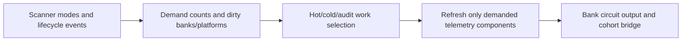

# Orbital scanner banks and demand caches

## Admin repair

`repair_runtime_state` unconditionally discovers scanners before rebuilding banks, platform caches and demand indexes. This repairs a partially missing registry while preserving per-unit scanner modes.

## Implementation sources

- [orbital-combinator.lua](../../../exotic-space-industries-remembrance/scripts/control/orbital-combinator.lua)

## Ownership and reference flow

The scanner owns `storage.ei.orbital_combinators`, bank and mode state, power sensors, platform caches, force/surface demand counts, hot/cold service queues, and optional probe records. Cohort logistics consumes narrow read-only bridge accessors rather than owning these caches.

Source eligibility is retained before item/quality aggregation. The default All view preserves aggregate outputs; Planet includes planet and all-source requests, Platforms includes platform and all-source requests. These are overlapping eligibility views, not a partition to add together. On the Way remains combined incoming cargo. Each platform's Need is computed independently before bank aggregation, subtracting stock/incoming once within the selected view. Source changes invalidate generation/page caches even when aggregate counts are unchanged.

Native 2.1.24 evidence shows compiled filters merge duplicate item/quality quantities and union source flags (numeric 2/3 despite the documented string type). Source-specific quantities therefore come from active effective sections, respecting multiplier and import location, bounded by native compiled totals. Manual, circuit and construction sections remain native-owned; reading them creates no alternative configuration store. The fixture retains raw and compiled filters when a source assertion fails.

The acquisition path uses native inventory totals and one component batch per platform service operation. Need is rebuilt after the required reads, once. A batch is never persisted or reused after a launch, request edit or inventory mutation, including mutations within one tick. Hot/cold budgets and update cadence are unchanged. Source selection is stored per unit and carried through bank regrouping and configuration copies. Existing generation caches, output pages and unchanged-output checks remain authoritative.

## Tick flow and invariants

Dispatcher step 5 provides the event for each work slice. One update selects and services one work class, marks it served, and reports remaining work. Preserve class fairness, hot/cold cadence, same-surface mirroring, and mixed-key cursor handling. Most helpers accept a numeric tick with a context-free fallback; some platform utility paths still read `game.tick` directly and require review when changing propagation.

Signal normalization and publication validate current signal and quality prototypes.
Removed identifiers are discarded and stale native section slots are cleared,
never rewritten as normal-quality requests. A Quality mod change invokes the
existing full repair path in the central dispatcher before banks may publish:
all prototype-derived platform caches are rebuilt, independent of audit slice size.

## Lifecycle and cleanup

Build/removal/settings paste, logistic-slot changes, platform movement, rocket/cargo-pod events, and object-destruction events invalidate specific cache components. Destroy callbacks distinguish a genuinely lost platform from a stale registration for one that still exists. Init/configuration rebuild repairs banks, helper power state, and platform indices. Demand transitions bootstrap newly requested data without eagerly scanning unused components.

## Bridge reads and circuit publication

A bridge read can acquire changed stock, requests or incoming cargo before a scheduled audit. It must wake affected banks through the existing deduplicated dirty-bank queue when the component changes. Merely updating the cache/generation is insufficient: the next audit then sees unchanged data and cannot rediscover the missed publication. This notification adds no polling loop, budget or cadence change; unchanged reads enqueue no work. The native fixture verifies stock increases and decreases reach actual circuit filters after a bridge read without forcing a bank update.

## Native circuit output isolation

Managed output sections stay outside named logistic groups. Native group names share their filters globally and cannot be used as local page headings: two banks using the same platform label would otherwise overwrite each other's source-filtered values. Page labels remain layout metadata; unlink a section before writing its filters and leave existing player groups intact. Runtime state version 6 invalidates derived caches and layouts once, retaining bank modes and source choices.

## Verification contract

test-suite: orbital-logistics

The registered 2.1.24 candidate/reload/configuration suite covers exact accounting and persistence with Quality enabled and disabled. The bulk reader and batching passed the matched 1/10/50-platform gate: 72 serial trials, 60 retained samples after warm-up, identical output/latency and lower active script and whole-engine update time. The [acceptance report](../../../scripts/qc/orbital-logistics/README.md) records the sparse workload, source normalization, API counts, timings and limits. Historical receipts and the mathematical non-equivalence of aggregate-first Need do not establish engine performance.

The [control UPS fixture](../../../scripts/qc/control-ups/README.md) includes scanner traversal and cached-count parity. Test demand-mode transitions, power loss, cargo lifecycle, platform deletion/replacement, multiple banks, hot/cold fairness, and ordinary/configuration reload. Check bridge payloads and actual circuit filters, not only queue counts.

## GUI refresh cost

Scanner power/mode changes refresh viewers of the affected bank. During one fanout, power and wiring summaries are computed once per bank and shared among viewers; no summary survives the event. Individual scanner power is read from the just-refreshed bank state. Unchanged modes, captions and power counts skip GUI assignments. The bank service remains the only scheduling owner.
