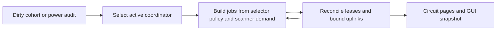

# Orbital logistics cohorts and leases

## Implementation sources

- [orbital-logistics.lua](../../../exotic-space-industries-remembrance/scripts/control/orbital-logistics.lua)
- [orbital-logistics-ui.lua](../../../exotic-space-industries-remembrance/scripts/control/orbital-logistics-ui.lua)

## Ownership and reference flow

`storage.ei.orbital_logistics` owns force/surface cohorts, transponder IDs, selectors, coordinators, uplinks, candidate jobs, target leases, dirty/power-audit queues, and GUI sessions. Scanner data enters through orbital-combinator bridge functions.

Native automatic lanes delegate loading, mixed-cargo batching, target selection and launch to Factorio and never take a lease. Placement records native intent without changing silo requests; explicit adoption requires an empty payload, no incoming cargo and no launch in progress. Existing records without a dispatch mode migrate to cohort control. External native request activation suspends competing cohort dispatch. The engine's read-only transitional target is observed, never assigned.

## Tick flow and invariants

Dispatcher step 10 passes the event to one cohort service slice. The update consumes pending rescans, then dirty cohorts before queued power audits. Numeric ticks flow into service, while init/QC/GUI utilities retain fallback reads. Per-pass scanner and silo caches must not escape that pass. Lease teardown may trigger one additional candidate rebuild in the same service so freed targets converge immediately.

Serialized signals are validated against current signal and quality prototypes.
Invalid demand is omitted from both manifests and totals, and stale native output
slots are cleared. Configuration rebuild retains the cohort/lease reconstruction
path; removing Quality never converts vanished-quality requests into normal-quality
shipments or changes already-paid numeric orbital execution contracts.

Rebuild snapshots player configuration before discarding derived registries. IDs, selector choices, binding identity, dispatch mode and retention survive; live leases do not. Paste/clones/blueprints serialize configuration only. Both ghost revival and the native `on_blueprint_settings_pasted` event apply blueprint tags; overwriting an existing entity releases its old lease before rebuilding derived state. Explicit IDs remain explicit and conflicts remain visible; copied automatic IDs are allocated anew. Automatic binding requires exactly one unambiguous adjacent silo. `on_rocket_launch_ordered` owns confirmed launch counts; the launch caller does not increment again after the synchronous event.

Rocket jobs use planet-eligible demand and recheck compiled eligible item/quality types immediately before launch. Excess quantities of eligible types are permitted. Power, owner, exclusive binding, coordinator, force and current location are rechecked at that boundary. A launch discards pass-local demand payloads before further reads.

## Native panels and viewer admission

`orbital-logistics-ui.lua` owns visible-session state under `native_gui`, with the existing dispatcher step 10 serving a bounded viewer queue every 30 ticks. Native hub/silo panels attach beside native windows; coordinator lists include native platforms without transponders. Tabs/search/location/page controls enumerate only the selected list and never sample hidden detail inventories. Closing a panel or leaving removes its interest. Hub/transponder details acquire exact data only while displayed; native-only lanes create no scanner bank demand. Advanced exposes IDs, repairs, leases, binding edits and retention floors; native windows remain the request editor.

Native hub/silo details stay relative to their native window: beside it on wide displays, below it on compact displays, with bounded scrolling. Resizing is reconciled by the existing visible-viewer service. Primary cohort details stay above expanded Advanced controls.

Overview entity links validate the live target and force, then use native remote-view centering before opening its window. This supports distant silos and platform hubs on other surfaces without moving a character. The normal native open/close events replace the overview session with destination details; stale row references are never dereferenced without validation.

Radar examples describe player-built same-force Universe channels, separate output/request-input wire colours and a constant presence signal. Shared channels are aggregate inventory only. No hidden radar, channel allocator, radio observer, platform reserve controller or alternate request store exists.

## Lifecycle and cleanup

Build/destroy/settings paste and platform/rocket events dirty relevant cohorts. Selector modes and oversize policies determine jobs; coordinator arbitration and existing lane rotation determine dispatch. Removal, retargeting, lost power, invalid bindings, and launch confirmation reconcile or release leases. Rebuild reconstructs world entities and registries; GUI close/leave destroys associated silo overlays.

The bound native `silo.launch_rocket` method receives the destination table directly.
Passing the silo again is an argument error, not a not-ready result; it previously
left a loaded, ready silo indefinitely leased without dispatching its cargo. The
protected call retains its error boundary and successful-launch bookkeeping.

## Native circuit output isolation

Managed constant-combinator sections have an empty native logistic group. Named groups share filters across entities, so labels such as `Platform ID` cannot be assigned to `section.group`. Detach before any slot write; leave existing player groups intact. Human page labels remain layout metadata. Runtime state version 9 rebuilds derived output state while preserving player configuration, so previously grouped outputs are repaired too.

## Verification contract

test-suite: orbital-logistics

Current acceptance requires the registered exact 2.1.24 `candidate`, `reload` and `configuration` cases in both Quality profiles. The current fixture preserves the saved world across configuration changes. GUI assertions use a graphical checkpoint and programmatic callbacks; they do not establish physical interaction or multiplayer. Scanner performance requires separate matched attribution and uninstrumented whole-engine measurements; reduced API activity alone is not a UPS result. The completed [native and performance acceptance](../../../scripts/qc/orbital-logistics/README.md) records both Quality profiles, actual cross-surface overview navigation, independent circuit outputs and the matched scanner performance gate.

The [control follow-up record](../../../scripts/qc/control-ups/followup-verification.md) documents a fixed-target fairness fixture and distinguishes GUI skips. Recheck sticky leases, competing fixed jobs, policy retargeting, mixed cargo, launch release, power loss, deleted silos, and reload. Existing historical results do not establish new multiplayer or interactive GUI coverage.

## Rebuild activity reporting

A deferred rescan reports queued activity until the existing callback consumes it. The blocking rebuild is recorded as synchronous, with duration unavailable; this change does not make it incremental. Pending requests coalesce. Ordinary transfers and logistics jobs remain excluded.
