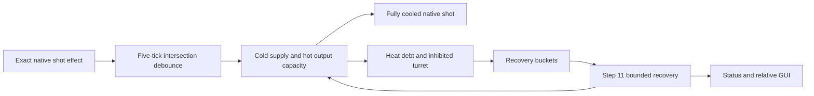

# Railgun coolant proxies, heat debt, and recovery

## Admin repair

`repair_runtime_state` retains live heat-debt records, deadlines and correctly bound coolant proxies. When a mismatched proxy must be replaced, its two fluid contents transfer to the new helper within prototype capacity; invalid owners use normal teardown.

## Implementation sources

- [railgun-cooling.lua](../../../exotic-space-industries-remembrance/scripts/control/railgun-cooling.lua)
- [railgun-cooling.lua](../../../exotic-space-industries-remembrance/scripts/data-updates/railgun-cooling.lua)
- [1.3.40.lua](../../../exotic-space-industries-remembrance/migrations/1.3.40.lua)

## Ownership and behavior

Native railgun firing emits `ei-railgun-cooling-shot`. Runtime owns hidden orientation-specific fluoroketone proxies, fluid conversion, heat debt, inhibition/status, recovery work, hot-shot visuals and a relative GUI. `storage.ei.railgun_cooling` stores turret records, proxy/turret destruction mappings, surface membership, viewers, unique recovery queues/buckets, earliest due tick and visual tails.

A cooled shot converts up to 10 cold fluoroketone to hot, constrained by both supply and output room. Missing coolant creates capped debt, nonlethal health loss and temporary inhibition; repair service consumes coolant or later passive bleed. No extra scripted weapon damage is applied to the enemy.

The helper's locked recipe cannot run in ordinary play: its hidden lock item has
no production route. In 2.1 its cold ingredient amount is 15 with multiplier 1,
because native input storage includes one additional ingredient batch. This
retains the native 2.0 cold capacity of 30. Its hot product keeps amount 30 with
explicit multiplier 2, retaining the actual 2.0 hot capacity of 60. The runtime
still converts exactly 10/10 per fully cooled shot; these hidden buffer declarations
do not change a player recipe or coolant economy. The GUI's historical nominal
three-shot bar is retained; it does not establish a 30-unit native hot capacity.

## Tick flow and deadlines

Handlers pass event/numeric tick through `now_tick`; eventless callers keep its fallback. Repeated line-intersection callbacks within five ticks are ignored. Recovery is scheduled +60 ticks; passive bleed begins after 300 ticks without a shot. Step 11 admits overdue buckets and services queued units under the shared dispatcher's budget. Healthy railguns are absent from steady-state recovery work. Status/GUI use the same supplied tick for remaining-time and visual expiry.

## Lifecycle and invariants

Build/clone/rotation create or align proxies; destruction registration repairs missing helpers or removes turret ownership. Platform state changes invalidate the relevant surface profile. Initialization and an explicit rebuild remove old records/orphan proxies and recreate helpers. Configuration changes instead use `repair_runtime_state`, retaining valid helper identities, coolant, heat debt and recovery deadlines. An ordinary upgrade must not use destructive rebuild as its migration path.

Migration `1.3.40.lua` repairs cached inserter drop targets that still point at coolant helpers. It scans actual inserters, resolves a railgun intersecting the drop tile, and retargets or clears that target without rebuilding helpers or discarding coolant. Prototype item-handling exclusions and this saved-target migration solve different lifecycle cases.

## GUI refresh ownership

Existing `open_by_player` continues to own viewers. GUI fluid/time snapshots are constructed lazily only after finding a connected matching viewer, then shared across those viewers. Captions, fluid/debt bars and profile/state fields write only when their displayed value changes. Existing shot/recovery cadence and live-time refresh behavior remain unchanged; no healthy-turret tick work is added. Local render snapshots are disposable and close/destruction clears them.

## Verification and maintenance

Exact 2.1.23 native checks pass all 288 inserter placements across eight directions
and both build orders, explicit helper rebuild/destruction recovery, and eight
10/10 coolant rigs with 30/60 native capacities. A real 2.0.77 donor migration
preserves all 296 helper identities and 2,091 state fields, including populated
fluids and pending heat debt 10 with deadline 359. A second save/reload and 600
ticks retain the fluid helper identities, connections and contents. See the
[upgrade synopsis](../handoffs/factorio-2.1/UPGRADE_SYNOPSIS.md#railgun-migration)
and the current `scripts/qc/factorio-2.1/stage_railgun.py` fixture instructions.
Explicit duplicate-shot boundaries, output-blocked recovery, passive bleed,
viewer teardown, rendered appearance and multiplayer remain separate checks.
