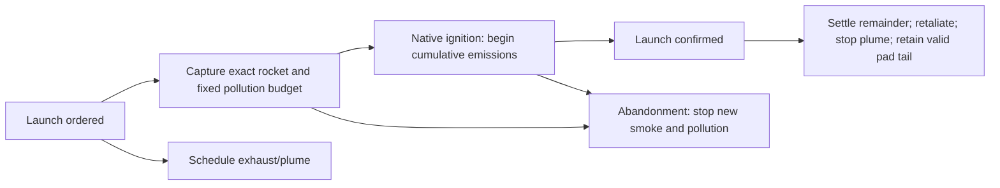

# Rocket launch consequences and visual scheduling

## Admin repair

`repair_runtime_state` adopts legacy records once and recomputes smoke/cleanup summaries. It preserves emitted balances, ignition ticks and confirmed ownership; it never emits pollution. Unverifiable legacy orphan smoke is retired, leaving existing particles to fade.

## Implementation sources

- [rocket-launch-pollution.lua](../../../exotic-space-industries-remembrance/scripts/control/rocket-launch-pollution.lua)
- [rocket-launch-plume-smoke.lua](../../../exotic-space-industries-remembrance/prototypes/rocket-launch-plume-smoke.lua)

## Ownership and reference flow

`storage.ei.rocket_launch_pollution` owns pollution-curve configuration, per-silo pending launches, detached launch records, delayed cleanup, and budgeted plume/spiral jobs. Each launch captures its silo, rocket, order tick, origin, fixed budget and emitted balance. Smoke jobs reference the same record, including its explicit confirmation state after pending-map removal. A new order moves an earlier airborne record to `detached_launches`, keyed by silo unit number and order tick, rather than overwriting its ledger.

The hidden `ei-rocket-launch-pollution` simple-entity is only a statistics identity, localized with the existing InformaTron heading and using the base rocket-part icon. It is never spawned, selectable, craftable or listed in Factoriopedia; death effects and interactive presentation are intentionally excluded. `surface.pollute(origin, delta, source_name)` updates native pollution and the graph together. There is no additional `on_flow` call.

## Tick flow and invariants

Impossible-difficulty retaliation respects the surface's native peaceful and no-enemies modes before selecting units or issuing commands. Launch pollution and visual scheduling remain independent of this native enemy policy.

Both launch events propagate `event.tick`. There is no native ignition event, so the gated updater checks only pending ordered launches each tick. `engine_starting`, `arms_retract` and `rocket_flying` permit combustion. The first observed burning tick emits one tick's share immediately; subsequent updates occur every 10 ticks. The cumulative target is `budget * min((tick - ignition_tick + 1) / 812, 1)`, and only the unpaid difference is emitted. Confirmation settles the exact remainder. A slow rocket may exhaust this reference profile before completing; a fast one settles a larger remainder. Visual style, particle budget and lingering smoke never change the pollution budget.

Pad smoke waits for verified ignition even with a short launch delay. Existing plume delay, handoff, particle budgets and visual lifetime remain authored cosmetic timing. Cancellation is checked before any new smoke or pollution. Supplied ticks reach counters; status/utility boundaries may read `game.tick` once.

## Lifecycle and cleanup

Before flight the captured rocket must remain attached; a different attached rocket cancels that sequence. After observed flight begins, the still-valid captured rocket is authoritative: native silo closure and construction of its next rocket do not end ascent. Invalid silo/surface/rocket or preflight abandonment cancels both emissions and matching visual jobs. Existing pollution is never refunded and existing particles fade naturally. Canceled records whose rockets still exist remain in `detached_launches` until invalidation or confirmation, checking validity once every 60 ticks; a late confirmation consumes the canceled record without a fresh fallback charge. Active detached launches still validate each tick.

Confirmation matches the captured rocket even when the event omits its silo, including a paid record retained only by a smoke job after loss of its pending index. It marks the shared launch record before clearing pending state and removes only that launch's plume. Surviving pad jobs thereafter validate the silo/surface, not the naturally disappearing rocket. Silo destruction still ends that tail. A new launch clears old visuals. Cleanup deadlines cannot discard a valid slow launch or its paid balance. Genuinely missing ordered records retain the full-budget fallback when the event silo or attached cargo pod supplies a surviving origin; the rocket's current elevated position is not a pad location. Schema adoption recovers old pending silo references once by unit number or exact saved position, verifies identity, then recovers the attached rocket with zero paid balance. A still-attached legacy rocket in flight or silo-closing phases is adopted as airborne. It never replays historical completed launches.

## Verification contract

Use the focused fixture under `scripts/qc/rocket-launch-pollution`. Test exact graph totals and cumulative arithmetic, zero pre-ignition emissions, all visual styles, delayed and canceled launches, destroyed silos/rockets, replacement identity, confirmation fallback, repeated/concurrent launches, multiple surfaces, repair and save/reload. Test Impossible retaliation on ordinary, peaceful and no-enemies surfaces. Record native event/phase timing separately from graphical ignition alignment and native graph presentation; a headless pass proves neither rendered result.
