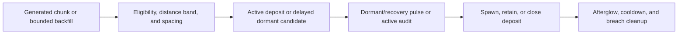

# Vulcanus auric fumarole lifecycle

## Admin repair

`repair_runtime_state` explicitly reconstructs active-band counts and rebuilds eligibility backfill on all eligible Vulcanus surfaces. The administrator-only `/rescan_auric_fumaroles` command does the same for the player's Vulcanus surface, or all eligible surfaces from the console. Existing active deposits, history and cooldown policy remain owned by the normal rescan implementation.

## Implementation sources

- [vulcanus-fumaroles.lua](../../../exotic-space-industries-remembrance/scripts/control/vulcanus-fumaroles.lua)

## Ownership and reference flow

`storage.ei.vulcanus_fumaroles` owns processed/history/cooldown chunks, generated/active distance-band counts, backfill and dormant queues, active deposits, breach-fire cleanup, and eligibility-version state. Chunk generation and resource depletion are the narrow world-entry events.

## Tick flow and invariants

The dispatcher calls `updater(event)` only through the module's due gate. Backfill, dormant pulses, active audits, and fire cleanup retain separate cadences and budgets; initialization/eligibility probes may wake outside the regular 30-tick boundary. Event ticks feed chunk/depletion work and scheduled processing; bootstrap/status utilities retain context-free reads. Preserve the actual gate precedence when reasoning about simultaneous work.

## Lifecycle and cleanup

Init/configuration bootstrap existing generated chunks without treating them as new world generation. Automatic eligibility refresh is owned exclusively by `FUMAROLE_RUNTIME_VERSION` and `ELIGIBILITY_VERSION`: a runtime mismatch requests refresh; an eligibility mismatch additionally resets the derived dormant state. General mod updates, including ESIR version changes, do not invalidate matching module versions. Existing queued backfill or a saved pending refresh resumes without being restarted. Initial/missing-state bootstrap and deferred probes for absent Vulcanus remain supported.

`check_global` reconstructs active-band counts only on either version mismatch or a missing count root, capturing those conditions before normalization. Reconstruction derives band membership from chunk coordinates. Registration and tracked closure maintain counts thereafter; recurring sanity/status calls preserve the count table. A synthetic untracked depletion record still receives ordinary closure effects and cooldown, but cannot remove or decrement a tracked index entry. Repeated adoption preserves the existing record's amount, touched state, spawn tick and expiry without incrementing counts again.

Depletion closes the exact deposit record, records cooldown/history, and schedules presentation cleanup. Dormant candidate and active-deposit indices must remain consistent across closure, expiry, and rebuild; spacing and local saturation constrain spawns. Rule/schema changes that require existing terrain to be reconsidered must deliberately bump the appropriate module version; this gating correction itself does not bump either version.

## Verification contract

The [control UPS fixture](../../../scripts/qc/control-ups/README.md) documents fumarole cadence decision probes. Test fresh chunks, pre-existing explored terrain, absent/reappearing Vulcanus, version refresh, blocked placement, depleted/expired deposits, simultaneous due work, reload, and eventual helper cleanup. Historical gate parity is not a claim about current long-run resource balance.

The [fumarole lifecycle fixture](../../../scripts/qc/auric-fumaroles/README.md) covers same-version configuration no-ops, migration admission, count reconstruction, tracked/untracked closure, repeated adoption, explicit repair, and native save/reload with pending backfill. Unrelated configuration changes must preserve queue order and rebuild-monitor progress.
